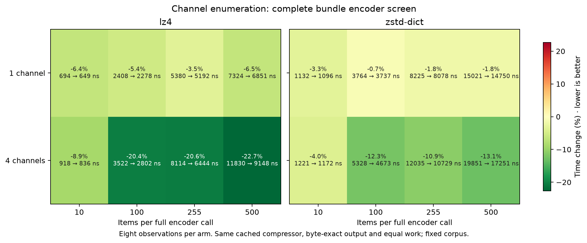
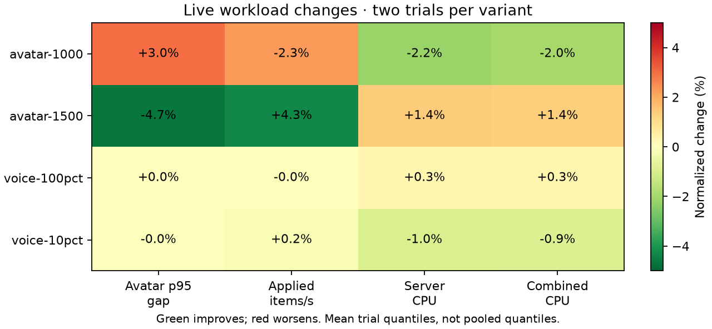
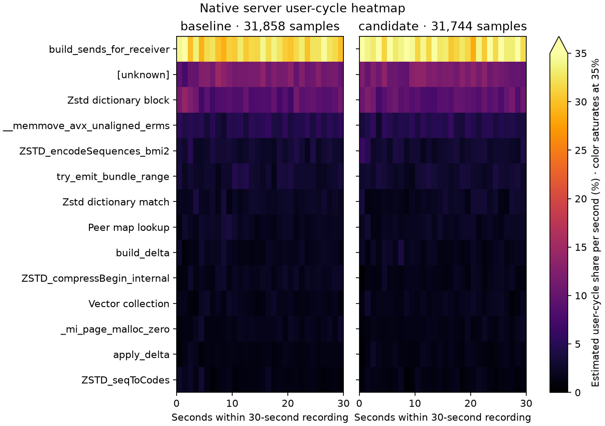

# Channel bitset — reverted pending confirmation, 2026-10-14

The complete encoder screen improves, but the matched live cohort trades delivery between workloads. Restored the accepted source when the allowance stopping point was reached. The proposal remains saved for a focused 1,000-avatar confirmation; no gain is claimed for the final branch.

The candidate replaces channel collection/sort/dedup with four u64 presence words drained in ascending order. Per-channel matching, chunking, emission, delta transposition, interval patches, compression and errors remain unchanged. Both screen arms use the same cached compressor, including the original zeroed zstd destination. The earlier zstd destination experiment remains reverted.

## Evidence

The fixed full-encoder screen covers 1/4 channels × 10/100/255/500 items × LZ4/zstd, eight observations per arm. Byte/decode equality, checksums and operation counts match. LZ4 changes −3.49% to −22.67%; zstd −0.71% to −13.10%. These fixed corpus results are component observations, not production capacity claims.

All four micro suites pass 12 commands / 37 subcases. All 16 live captures pass measured coverage, delivery, errors, delta/sequence and voice cadence/fanout/hash/decode gates. Setup retries are separate from zero measured retries. Frozen binaries, fixtures, audio identities, 16 server Tokio/Rayon workers, four client workers and 20/60-second windows match.

| Workload | p95 gap, ms | Applied items/s | Server CPU, cores | Client CPU, cores |
|---|---:|---:|---:|---:|
| avatar-1000 | 154.44 → 159.06 | 6926 → 6768 | 4.6038 → 4.5042 | 0.5589 → 0.5565 |
| avatar-1500 | 317.85 → 303.06 | 5209 → 5434 | 4.9500 → 5.0189 | 0.8505 → 0.8601 |
| voice-100pct | 20.70 → 20.71 | 4932 → 4930 | 1.6438 → 1.6487 | 1.0968 → 1.0995 |
| voice-10pct | 21.56 → 21.55 | 12279 → 12302 | 2.9051 → 2.8768 | 0.9533 → 0.9477 |

At 1,500 avatars, p95 improves 4.65% and delivered items increase 4.32%, with server CPU +1.39%. At 1,000 avatars, p95 worsens 2.98% and delivered items fall 2.28%, with server CPU −2.16%; both crossover orders deliver fewer updates. Voice delivery and cadence stay close to flat. Two runs per variant do not resolve host variability; means of run quantiles are not pooled quantiles.

Native 30-second server `cycles:u` / DWARF recordings contain 31,858 / 31,744 samples and zero lost samples. Unknown shares are 11.47% / 11.55%, retained in the denominator; client recordings also pass zero-lost checks. Relative shares do not establish absolute CPU savings.

Candidate checks pass 369 server and 116 client release tests, both hardware GPU parity tests, formatting and protocol all-target Clippy with warnings denied. Six new byte-exact tests cover all 256 channels, word boundaries, duplicate ordering, over-255 chunk continuation, delta interval patches, empty inputs and errors. Muse Spark reports no production logic issue. Its temporary-source warning was caused by the intentional control swap during matched builds; root verified restoration and source hashes. The screen now requires an explicit frozen binary.

The `captures/optimization-evidence-20261014/docs/performance/optimization-20261013-bundle.json` (local only), all heatmaps, matched sources/build commands, full encoder screen and review response remain under `captures/optimization-followups-20261013/bundle-channels/`. The final source is byte-identical to `final-control.rs`; earlier accepted optimizations are preserved. The separate read-bit proposal remains unapplied and uncompiled.

A [new matched confirmation](optimization-20261014-channel-confirm.md) repeats the 1,000-avatar regression on the accepted decoder base; the bitset remains reverted.
