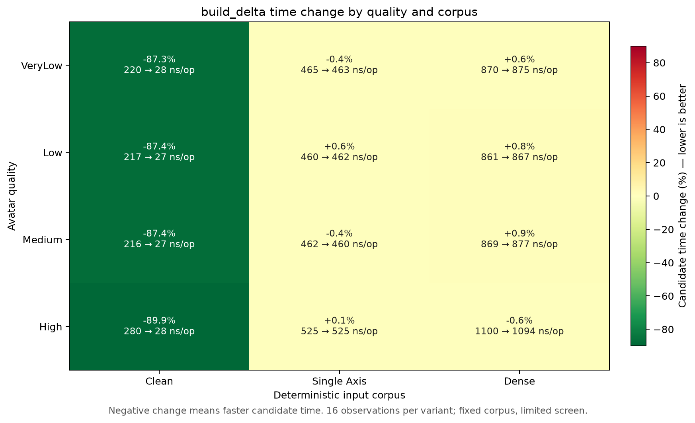
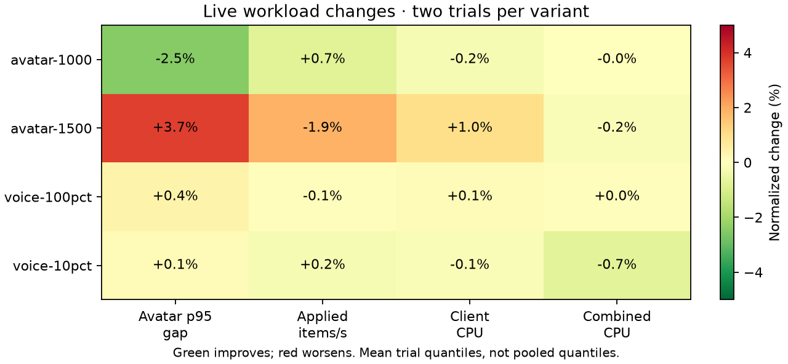
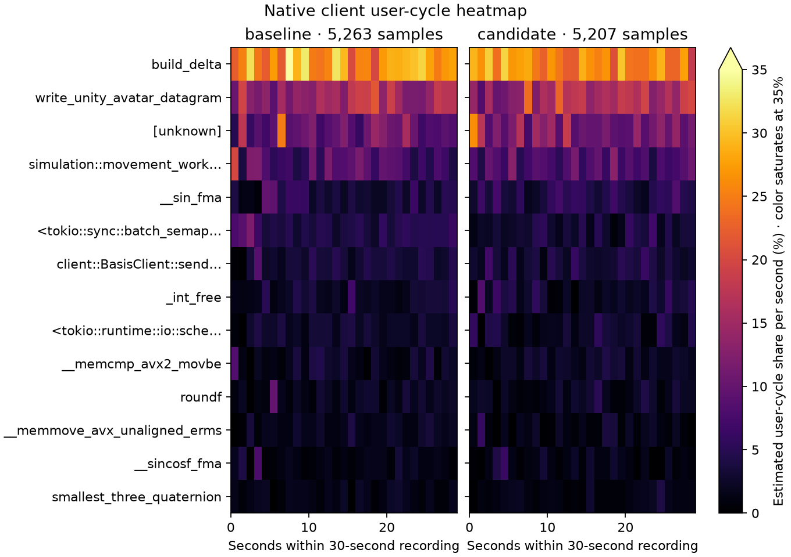

# Exact-clean delta shortcut — retained, 2026-10-13

Retained for a measured 87–90% reduction in full encoder cost on byte-identical fixed payloads. Sparse and dense cases remain within 1% in the matched screen. Live results do not establish a general CPU or capacity gain.

`build_delta` now compares the fixed payload prefixes after both existing length checks and immediately returns the exact five-byte zero dirty mask when equal. Unequal prefixes use the existing encoder. Trailing avatar data, errors, quality layouts and wire bytes remain unchanged. Callers borrow or copy the body and keep additional avatar data separately; they do not rely on the old spare capacity.

## Matched encoder screen

Both frozen variants use identical locked release build commands, Rust 1.95.0, `CARGO_PROFILE_RELEASE_DEBUG=1`, package features and test harnesses. The control retains the previous accepted encoder implementation. All 96 quality/case/round records are required in each A/B/B/A trial: 16 observations per variant for each of four qualities × clean/single-axis/dense cases. Operations, output checksums, corpus identities and zero-residual counts match; every input round-trips before timing. The timer includes allocation and the complete encoder call.

| Quality | Clean control, ns/encode | Clean candidate, ns/encode | Change |
|---|---:|---:|---:|
| VeryLow | 219.57 | 27.93 | -87.28% |
| Low | 217.23 | 27.41 | -87.38% |
| Medium | 216.42 | 27.37 | -87.35% |
| High | 279.53 | 28.30 | -89.88% |

These repeated fixed-corpus observations are not a significance test or a production workload mix. Preliminary parser, analysis-overlap and automatic-worker confirmation runs remain preserved and excluded.

## Live validation and confirmation

All 16 standard captures pass measured delivery, coverage, errors, delta/sequence and voice cadence/fanout/hash/decode gates. All four common micro suites pass 12 commands / 37 subcases. Fixtures, real 20 ms Opus corpus, ports, 16 server Tokio/Rayon workers, four client workers and 20/60-second warmup/measurement windows match. Setup retry failures remain separate from zero measured retry deltas.

| Workload | Avatar p95 gap, ms | Applied items/s | Server CPU, cores | Client CPU, cores |
|---|---:|---:|---:|---:|
| 1,000 avatars | 162.91 → 158.86 | 6718 → 6768 | 4.5232 → 4.5236 | 0.5605 → 0.5593 |
| 1,500 avatars | 307.47 → 318.88 | 5321 → 5222 | 4.9464 → 4.9290 | 0.8515 → 0.8599 |
| 250 clients / 25 speakers | 21.55 → 21.59 | 12274 → 12300 | 2.8862 → 2.8595 | 0.9507 → 0.9494 |
| 100 clients / 100 speakers | 20.67 → 20.75 | 4930 → 4928 | 1.6496 → 1.6492 | 1.0981 → 1.0996 |

The first 1,500-avatar cohort has p95 +3.71% and application throughput −1.88%. One crossover order delivers more updates, the other fewer, so a second A/B/B/A series repeats only this workload with the exact same binaries, inputs and explicit worker environment. Every confirmation capture passes the same single-case eligibility/input logic; no missing benchmark families were fabricated.

Confirmation means improve p95 321.53 → 307.66 ms (−4.31%) and application throughput 5184 → 5334 items/s (+2.89%), with server CPU +1.74% and client CPU +1.00%. Across all four observations per variant, p95 is 314.50 → 313.27 ms, application throughput 5253 → 5278 items/s, server CPU 4.9307 → 4.9648 cores and client CPU 0.8498 → 0.8583. Means of run quantiles are not pooled quantiles. This near-flat combined delivery and slightly higher CPU supports the limited encoder claim, not a capacity claim; the differing crossover blocks demonstrate host variability.

## Native evidence and correctness

Matched 1,500-avatar 30-second, 199 Hz `cycles:u` / DWARF client recordings have 5,263 / 5,207 samples and zero lost samples. Both server reports also have zero lost samples. Event-period-weighted `build_delta` share changes 27.09% → 25.49%; unknown symbols remain in the denominator (10.49% → 11.83%). Relative recorded-cycle shares do not establish an absolute CPU saving. Heatmap colors explicitly saturate at 35%.

The candidate passes 363 server workspace and 116 client workspace release tests, both ignored hardware GPU parity tests, formatting and protocol all-target Clippy with warnings denied. Frozen control and candidate each pass 18 focused delta tests. New checks cover all four clean qualities, trailing data and consumed-byte boundaries, exact error strings/order, and every fixed-prefix bit against the existing decoder reference. Earlier ownership, membership, quaternion packing and bulk residual encoding changes remain intact.

The `captures/optimization-evidence-20261014/docs/performance/optimization-20261013-clean.json` (local only), PNG/SVG figures, matched build commands, source snapshots, frozen binaries, complete encoder corpus, confirmation series and profiler recordings are retained. Raw files are under `captures/optimization-followups-20261013/delta-clean/`.
