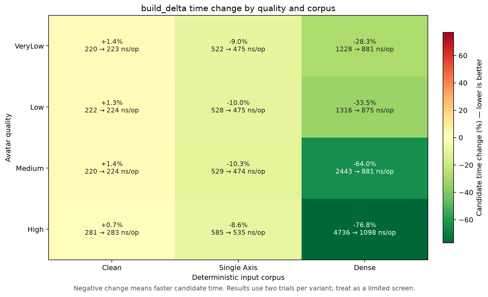
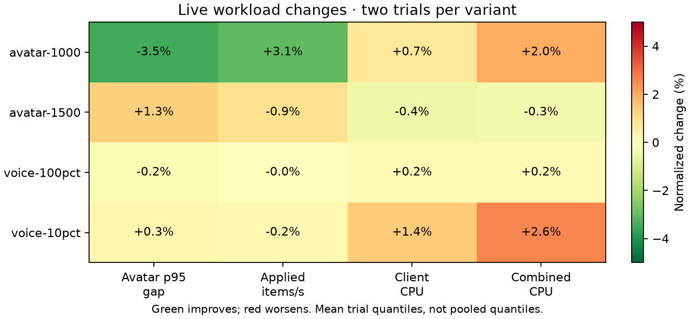
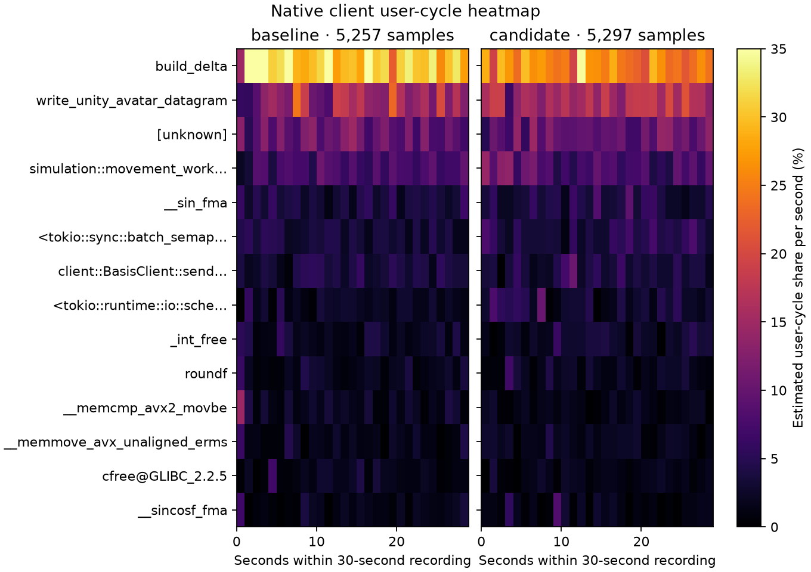
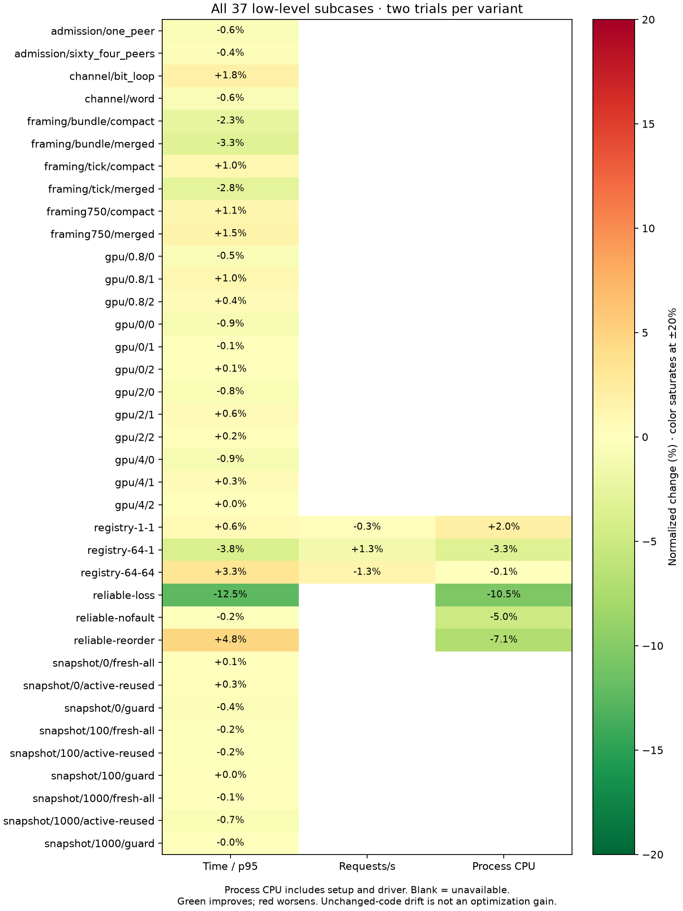

# Bulk residual encoding — 2026-10-13

Retained for the consistent full-encoder reductions on changed payloads and byte-equivalent output. This is a bounded encoder optimization: whole-process CPU and latency are mixed, so it establishes no general capacity increase.

The candidate changes only `ResidualBitWriter`: unaligned fields are written by byte chunks, and signed Exp-Golomb codes are assembled before one bulk write. The zero residual remains a one-bit fast path. Masks preserve adjacent fields; field order, code lengths, delta mode selection, layouts, and decoded payloads remain unchanged.

Control includes the accepted [ownership](optimization-20261013.md), [membership](optimization-20261013-membership.md), and [client packing](optimization-20261013-packing.md) changes. Both the server and Rust client encode residuals, so each variant uses its own frozen server and client. Audio, fixtures, worker counts, ports, warmup, and measurement windows remain fixed.

## Targeted encoder screen

The new ignored `bench_build_delta_corpus` harness measures full encoding, including allocation, on 32 deterministic payload pairs per corpus and quality. Clean inputs are unchanged. Single-axis inputs change one component in each selected bone field, leaving the other components unchanged. Dense inputs use independent deterministic payloads. Each case verifies exact reconstruction and consumed length before timing. The test-only legacy writers independently verify wire bytes at all alignments, exact-end buffers, patterned neighbors, 0–64-bit fields, concatenated codes, and signed boundary values.

Frozen binaries ran A/B/B/A, eight rounds per case and 32,768 operations per round. All corpus identities, operation counts, and timed checksums match. Mean trial medians changed as follows:

| Quality | Clean | Single axis | Dense |
|---|---:|---:|---:|
| VeryLow | +1.36% | −9.01% | −28.29% |
| Low | +1.27% | −10.02% | −33.50% |
| Medium | +1.37% | −10.34% | −63.95% |
| High | +0.66% | −8.55% | −76.82% |

These are synthetic encoder costs, not whole-client or server capacity gains. Clean inputs do not exercise residual writing. Native counters and every timing sample remain in the local capture directory. A post-capture presentation error in the local driver was corrected by reading its already-written JSON; none of the four successful benchmark processes was rerun or replaced.



## Matched live results and native profiles

All four workloads ran A/B/B/A with 20-second warmup and 60-second measurement windows. Values are means of two trial values per variant; quantiles are not pooled and these shared-host samples do not establish statistical significance.

| Workload | Avatar p95 gap, ms | Applied items/s | Server CPU, cores | Client CPU, cores | Combined CPU, cores |
|---|---:|---:|---:|---:|---:|
| 1,000 avatars | 158.23 → 152.74 | 6752 → 6960 | 4.4795 → 4.5753 | 0.5613 → 0.5652 | 5.0408 → 5.1405 |
| 1,500 avatars | 304.07 → 308.01 | 5359 → 5309 | 4.9682 → 4.9552 | 0.8599 → 0.8564 | 5.8281 → 5.8116 |
| 250 clients / 25 speakers | 21.55 → 21.62 | 12309 → 12283 | 2.9027 → 2.9897 | 0.9474 → 0.9604 | 3.8500 → 3.9502 |
| 100 clients / 100 speakers | 20.72 → 20.68 | 4932 → 4931 | 1.6413 → 1.6437 | 1.0965 → 1.0985 | 2.7378 → 2.7422 |

At 1,000 clients, p95 improves in both crossover orders with more delivered updates and more CPU. At 1,500 clients the forward pair worsens cadence, while the reverse pair is nearly flat in p95 and delivers slightly more updates. The aggregate 1.3% worse p95 and 0.9% fewer updates remain visible. Voice cadence and delivery are nearly flat, with up to 2.6% more combined CPU. These results do not support a whole-process CPU reduction or universal latency improvement.

All 16 captures passed measured population, sender progress, observer coverage, protocol/decode/delta/sequence/drop, and voice cadence/fanout/hash/decode gates. Legacy cumulative setup retransmissions remain visible separately; measurement-window retransmission deltas are zero. No work or validator was removed to obtain the encoder gains.



Matched 30-second client profiles at 199 Hz `cycles:u` with DWARF call stacks contain 5,257 control / 5,297 candidate samples and zero lost samples. Event-period-weighted `build_delta` share falls **30.74% → 25.43%**. This is a relative share of recorded user cycles, not elapsed encoder time or absolute CPU saved. Unknown symbols remain in the denominator and full JSON; the heatmap shows the top symbols and complete seconds.



All 12 common low-level command cases / 37 subcases passed in four adjacent matched suites. Timing differences in unchanged benchmark code are retained as drift and are not credited as residual-writer gains.



## Verification and evidence

All 357 server workspace release/GPU tests and 116 client workspace release tests passed. Frozen candidate GPU parity tests passed. All-target protocol, server core/GPU, and client core Clippy passed with warnings denied. A fresh CodeRabbit review reported zero findings in the changed protocol file. An independent wire-format audit found no issue in the supported domain: protocol channels are at most 24 bits. The private signed-code helper still does not support `i32::MIN`, which cannot arise from those channels; it is not a general-purpose full-range signed encoder.

Raw commands, statuses, native counters, source snapshots, frozen binaries, targeted samples, and full-workload captures remain in `captures/optimization-followups-20261013/delta-writer/`. The preliminary control probe is separate from the matched cohort. The shared comparison tool validates each variant's binary identities and completion statuses, permitting only the declared expected client identity difference while retaining all delivery and voice gates.

The analyzer now rejects ineligible live comparisons before aggregation or plotting and requires a native report with zero lost samples. A fresh tooling review found two minor issues: timed-out micro commands could be accepted if their exit code was zero, and micro/profile manifests were not checked against frozen identities. Both were fixed. Focused synthetic tests cover those cases, failed eligibility, micro/profile identity changes, and missing, malformed, or nonzero lost-sample reports, alongside existing binary/workload identity checks. The complete cohort passes those guards.

The `captures/optimization-evidence-20261014/docs/performance/optimization-20261013-delta.json` (local only) and PNG/SVG exports are retained. Reproduce using the [Linux suite runner](../../scripts/perf/run-linux-optimization-suite.py) with each variant's frozen server and `--client` executable, then:

```sh
python3 scripts/perf/compare-optimization-suite.py captures/optimization-followups-20261013/delta-writer \
  --client-change-reason 'Protocol residual writer affects client and server' \
  --profile-target client --output docs/performance/optimization-20261013-delta
```
