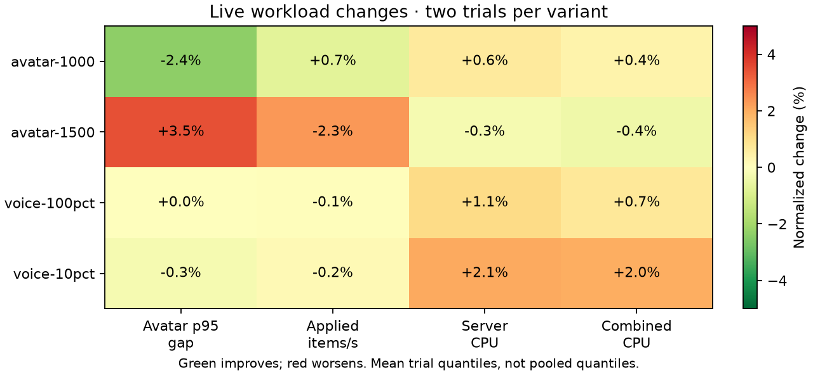
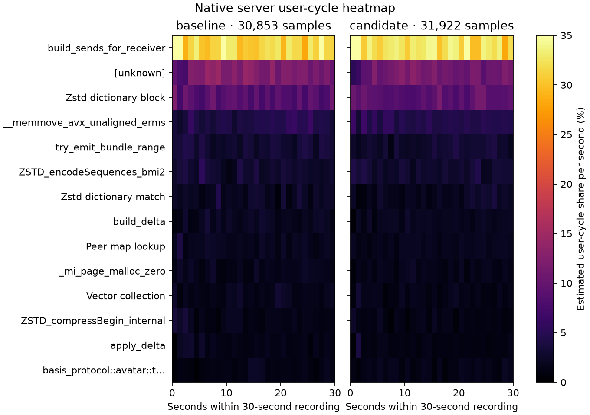
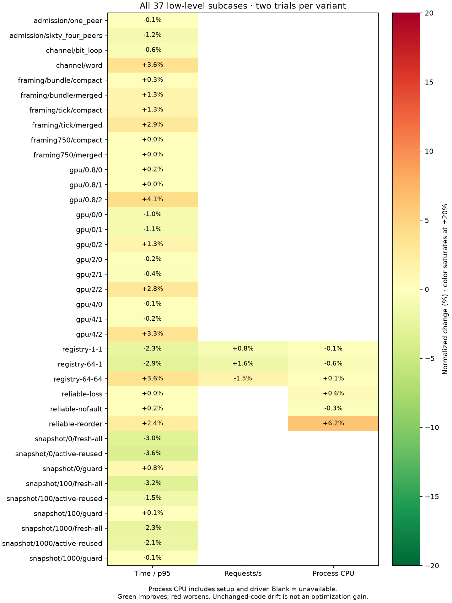

# Receiver roster indices — rejected, 2026-10-13

Rejected and reverted. Carrying each receiver's immutable roster index removed its repeated linear search and selected-state Arc clone, but the matched 1,500-client workload delivered fewer updates with worse p95 gaps. The previous accepted ownership, membership, client-packing, and residual-writer changes remain intact.

The candidate validated each index and receiver ID before creating tracking state, retaining all incarnation, membership-generation, roster-identity, and post-encode checks. Packet differential, reordered/out-of-range/stale-index, bounded-cycle, and blocked-encoding race tests passed. Independent OpenCode Muse Spark review found no correctness issue. Correctness alone did not justify retaining it as a performance change.

## Matched results

Both frozen builds use Rust 1.95.0, locked release with `CARGO_PROFILE_RELEASE_DEBUG=1`, the same client, fixtures, real 20 ms Opus corpus, worker counts, ports, and 20/60-second warmup/measurement windows. A first nonmatching build was discarded before timing. A/B/B/A gives two observations per variant; these shared-host means are not pooled quantiles or significance estimates.

| Workload | Avatar p95 gap, ms | Applied items/s | Server CPU, cores | Combined CPU, cores |
|---|---:|---:|---:|---:|
| 1,000 avatars | 157.93 → 154.22 | 6860 → 6910 | 4.5716 → 4.6003 | 5.1350 → 5.1548 |
| 1,500 avatars | 307.38 → 317.99 | 5359 → 5234 | 4.9862 → 4.9734 | 5.8456 → 5.8206 |
| 250 clients / 25 speakers | 21.65 → 21.60 | 12295 → 12273 | 2.8828 → 2.9424 | 3.8245 → 3.9000 |
| 100 clients / 100 speakers | 20.72 → 20.72 | 4929 → 4926 | 1.6406 → 1.6581 | 2.7372 → 2.7567 |

At 1,500 clients, both crossover orders worsen p95 (+5.04% / +1.82%) and reduce application throughput (−4.23% / −0.46%). Mean CPU is almost flat; its small reduction cannot be credited while delivery declines. The 1,000-client observations improve cadence in both orders with slightly higher CPU, but do not offset the failed larger workload screen. The mechanism of these differences remains unisolated.

All 16 captures pass measured population, sender progress, coverage, error/drop, delta/sequence, and voice cadence/fanout/hash/decode gates. Legacy setup retry failures remain separate from zero measured retry deltas. The [strengthened comparison guards](optimization-20261013-round2-tooling.md) verify corpus hashes and complete micro sample counts.

## Native profiles and checks

Matching 30-second, 199 Hz `cycles:u` / DWARF server recordings have 30,853 control / 31,922 candidate samples and zero lost samples. Event-period-weighted `build_sends_for_receiver` share rises 31.78% → 32.67%; it does not corroborate a build-cost reduction. These are relative recorded-cycle shares with unknowns preserved, not absolute time.

All four common micro suites passed all 12 commands / 37 subcases. Their unchanged-code timing differences are not credited as optimization gains.

The candidate passed 358 server workspace release/GPU tests, 49 focused avatar tests under matched build settings, all-target server core/GPU Clippy with warnings denied, and both ignored hardware GPU parity tests. A race fixture initially assumed index zero for an unordered DashMap roster; it was corrected to derive the index before any timed trial.

The `captures/optimization-evidence-20261014/docs/performance/optimization-20261013-index.json` (local only), PNG/SVG figures, frozen binaries, source/control snapshots, review text, commands, native data, and rejected results remain in `captures/optimization-followups-20261013/receiver-index/`. Only the experiment's production changes were reverted by restoring its saved control source; no broader checkout rollback was used.
