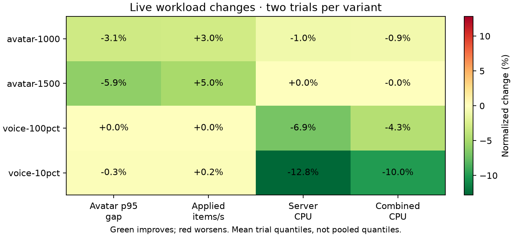
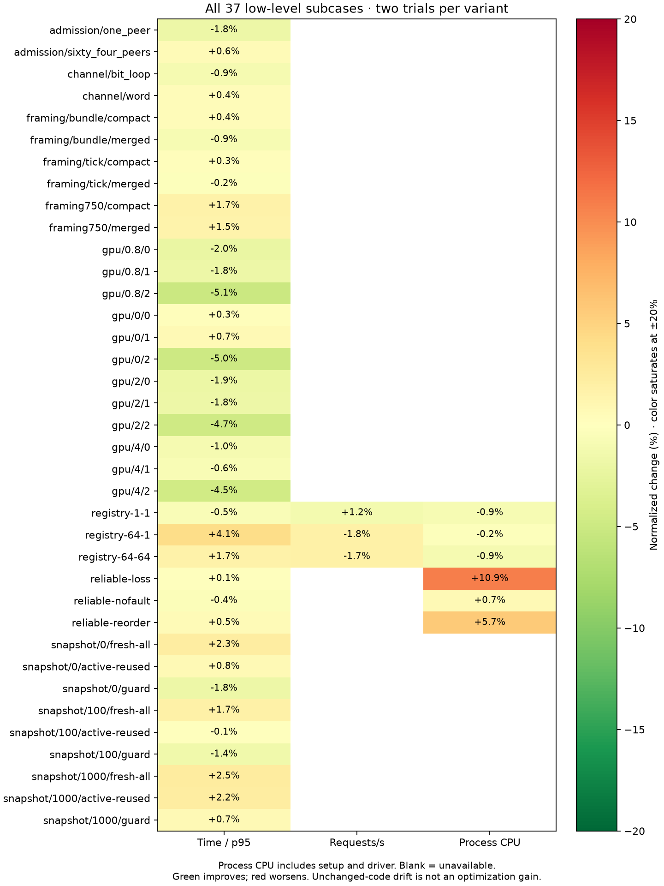
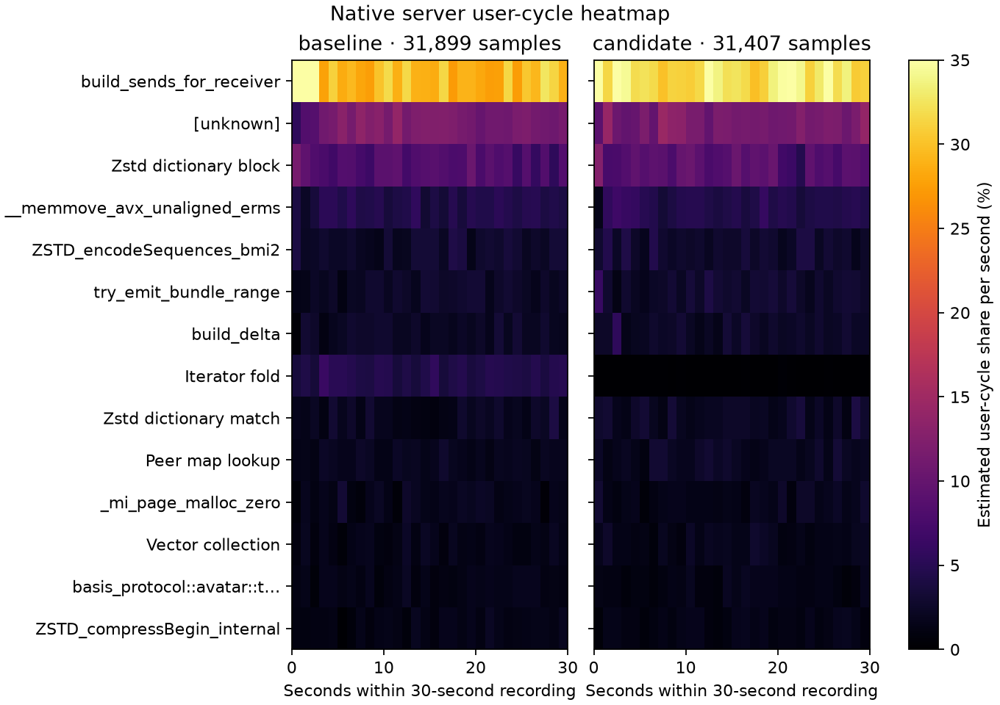

# Shared membership snapshot — 2026-10-13

Retained: compute sender liveness once per immutable avatar tick roster, rather than repeating the full membership lookup for every receiver. Each receiver checks the membership generation and roster identity under the admission lock. A join, departure, peer-ID reuse, or different roster causes a fresh census. Existing receiver admission and end-of-encoding incarnation checks remain in place.

This comparison starts from the [previous payload ownership optimization](optimization-20261013.md), not the original committed baseline. The candidate adds only membership sharing to production code in `avatar_sync.rs`. The common frozen workload client, server fixture, scheduling settings, and 40 preencoded real Opus clips are unchanged.

## Matched live results

Each workload ran sequentially in A/B/B/A order, twice per variant, with 20 seconds of warmup after readiness and a 60-second measurement window. Values are means of trial quantiles/rates, not pooled quantiles. CPU uses actual process-counter endpoints. The environment and workload limitations are the same as the previous report.

| Workload | Avatar p95 gap, ms | Applied items/s | Server CPU, cores | Combined CPU, cores |
|---|---:|---:|---:|---:|
| 1,000 avatars | 159.65 → 154.77 | 6660 → 6860 | 4.597 → 4.552 | 5.180 → 5.134 |
| 1,500 avatars | 331.41 → 311.72 | 5022 → 5271 | 4.910 → 4.912 | 5.798 → 5.798 |
| 250 clients / 25 speakers | 21.61 → 21.55 | 12259 → 12287 | 3.355 → 2.925 | 4.310 → 3.879 |
| 100 clients / 100 speakers | 20.74 → 20.75 | 4930 → 4931 | 1.771 → 1.649 | 2.875 → 2.750 |

Both crossover orders improved p95 gaps and delivery at 1,000 and 1,500 clients. At 1,500 clients, mean p95 fell 5.9% and application throughput rose 5.0%, with flat combined CPU. Both valid voice workloads retained cadence/delivery while using less server CPU: 12.8% and 6.9%, respectively. Voice arrival validation passed; these avatar gaps are not end-to-end audio latency measurements.

All 16 captures passed measurement-window eligibility: complete active/authenticated populations and observer coverage, sender progress, and zero measured send/decode/protocol/delta/sequence/drop errors. Every voice capture additionally passed offered cadence, unique fanout receipt, payload/hash, and Opus decode gates for all receivers. Setup-only reliable retries still fail the legacy cumulative `zero_retransmits` flag in some 1,500-client captures. Strict failures, setup counts, and zero measurement-window retry deltas are preserved in the data.

An earlier independent 1,500-client A/B/B/A screen also passed all measured gates and averaged 4.4% lower p95 gaps and 4.2% more applied updates, with flat CPU. Its reverse pair was nearly flat, which prompted the full confirmation above. Both cohorts remain locally; no failed trial was replaced. Two trials per variant in the full cohort are limited evidence on one shared host, not statistical significance or a universal capacity claim.

## All benchmarks and native profiling

All 12 low-level command cases / 37 subcases passed in the adjacent A/B/B/A cohort, including exact registry operations, reliable delivery under loss/reorder, admission, peer snapshots, protocol extraction, client framing, and GPU distance-consumption checksums. Registry rates varied from +1.2% to −1.8%; unchanged-path GPU timings also varied. These timings are not credited as additional optimization gains. Every command retained `perf stat` counters for task-clock, cycles, instructions, cache references/misses, and context switches.

Separate matched 1,500-client diagnostic captures recorded server and client user cycles at 199 Hz with 8 KiB DWARF stacks for 30 seconds. Server profiles contain 31,899 control / 31,407 candidate samples and zero lost samples. Event-period-weighted iterator-fold share fell 4.45% → 0.09%, consistent with removing the repeated census. These shares are relative costs, not absolute CPU times. The plots preserve unknown symbols and omit the final partial second; JSON retains all sampled symbols, including costs that fall below the displayed top rows.

## Verification and artifacts

The server workspace passed 355 locked release/GPU tests; the separate client workspace passed 115 tests before the subsequent packing experiment. Both ignored hardware GPU parity tests passed. Core/GPU all-target Clippy with warnings denied, formatting, and diff checks passed. CodeRabbit found zero issues in the changed Rust file.

New tests compare shared and fresh census output after departure/reuse and reject a snapshot from a different roster order. Existing byte-equivalence tests now exercise the shared fast path. Both deterministic blocked-encoding tests use the shared snapshot and verify receiver/sender reuse cancels stale output without blocking registration or suppressing a required retry.

The `captures/optimization-evidence-20261014/docs/performance/optimization-20261013-membership.json` (local only) and PNG/SVG exports retain the complete cohort. Commands, statuses, hashes, frozen executables, source snapshots, raw captures, both native recordings, and the initial screen remain in ignored `captures/optimization-followups-20261013/membership/`. Frozen `baseline/` is the previously accepted ownership implementation; `candidate/` adds membership sharing.

Separate 250-client / 250-speaker overload captures still failed capacity and avatar freshness/delta checks in both revisions. Unique receipt was 87.70% / 87.85% of offered fanout; neither met nominal send cadence, voice reordering, or p95 arrival gates. These unreplicated failed diagnostics remain in `baseline-stress-final/` and `candidate-stress-final/`, excluded from speed claims. Membership sharing establishes no 250-speaker capacity improvement.

Reproduce with the [Linux suite runner](../../scripts/perf/run-linux-optimization-suite.py) and [analyzer](../../scripts/perf/compare-optimization-suite.py), using the same commands and settings as the prior report and this capture root. Use tags `abba1 abba2` for both live and micro, and `initial final` for profiles. Build/test/plot work was kept outside timed measurements.

The analyzer now validates each client's frozen binary identity as well as the server's. A future client implementation comparison must explicitly provide `--client-change-reason`; every other workload input and validation gate remains fixed. `--profile-target client` selects client heatmaps. Focused checks passed three valid identity paths and nine rejection cases, including altered voice cadence, receive mode, fixture, and client/server identities.
