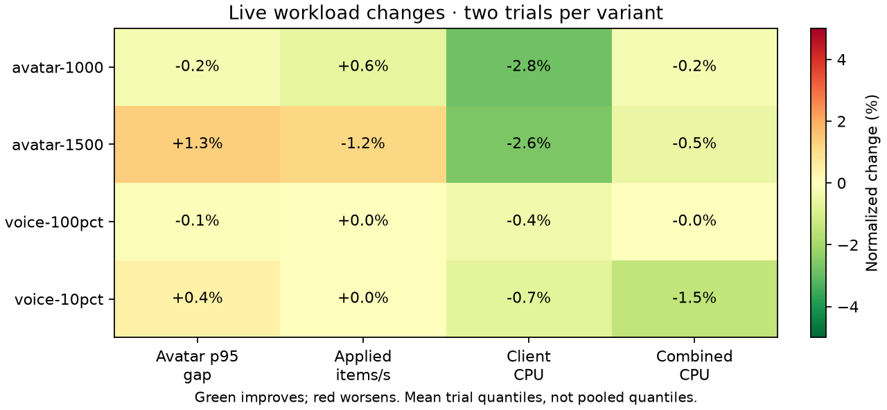
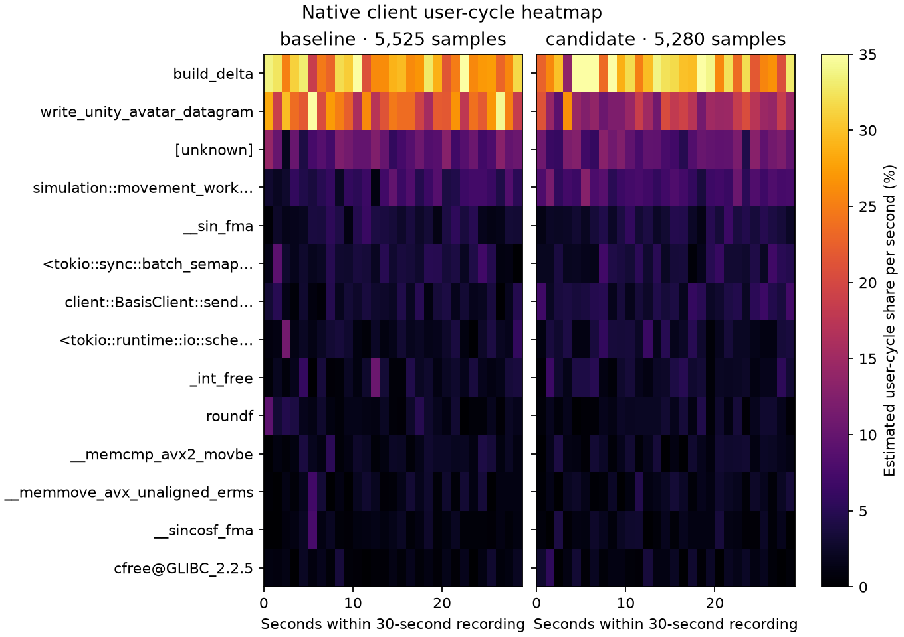
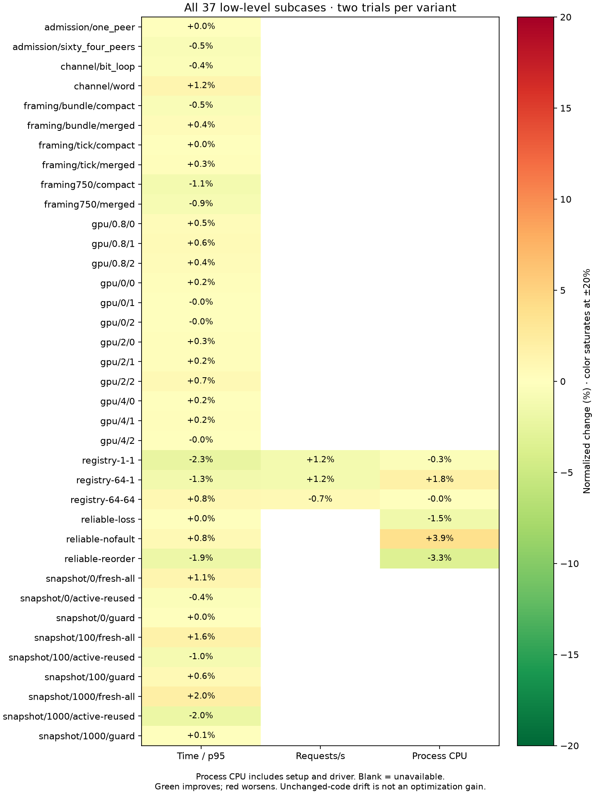

# Client quaternion packing — 2026-10-13

Retained: write each unaligned quaternion field by byte chunks instead of modifying every bit separately. The mask preserves adjacent fields and consumes the same least-significant bits. Production uses nine 38-bit fields; differential tests cover every bit alignment, counts 0–64, exact-end buffers, patterned neighbors, and varied values.

Control already includes the [ownership](optimization-20261013.md) and [membership](optimization-20261013-membership.md) changes. Only the workload client's packing implementation differs; both variants use the identical frozen server, fixtures, scheduling settings, and real Opus corpus. This reduces Rust client/load-generator CPU. It does not establish a speedup for the Unity C# client.

## Matched results

The added ignored `profile_quaternion_packing_cpu` harness precomputes the same 256 deterministic synthetic poses for both writers. It verifies whole payload equality before timing, then writes nine fields per pose through opaque function pointers with matching call overhead. Each executable runs eight alternating production/reference samples of 131,072 poses. Frozen binaries ran A/B/B/A after all builds finished.

Mean trial median production cost fell **415.5 → 48.3 ns/pose (88.4%)**. All 64 timed production/reference round checksums match. This isolates packing from quaternion math, delta encoding, and network work; it is not an 88.4% whole-client improvement. Whole-process `perf stat` counters and every sample remain locally.

All four live workloads also ran A/B/B/A, with the same 20-second warmup and 60-second windows as earlier reports:

| Workload | Avatar p95 gap, ms | Applied items/s | Client CPU, cores | Client user CPU, cores | Combined CPU, cores |
|---|---:|---:|---:|---:|---:|
| 1,000 avatars | 155.70 → 155.39 | 6843 → 6885 | 0.5810 → 0.5645 | 0.2060 → 0.1889 | 5.1329 → 5.1227 |
| 1,500 avatars | 301.63 → 305.69 | 5384 → 5321 | 0.8893 → 0.8659 | 0.3089 → 0.2866 | 5.8593 → 5.8275 |
| 250 clients / 25 speakers | 21.54 → 21.64 | 12291 → 12291 | 0.9573 → 0.9507 | 0.3421 → 0.3366 | 3.8752 → 3.8187 |
| 100 clients / 100 speakers | 20.73 → 20.71 | 4928 → 4930 | 1.0998 → 1.0959 | 0.3201 → 0.3185 | 2.7461 → 2.7461 |

Client user CPU improved in both crossover orders at 1,000 clients (−8.0% / −8.6%) and 1,500 clients (−5.7% / −8.7%). Total client CPU fell 2.8% / 2.6% in those cases. Voice CPU differences are smaller. Server cadence is essentially flat; the 1,500-client means show 1.35% worse p95 gaps and 1.16% less application throughput. The first forward comparison had worse cadence while the reverse was nearly flat. These limited shared-host observations establish no server capacity or latency improvement for this client change.

All 16 live captures passed measurement-window eligibility, including population, observer coverage, sender progress, decode/protocol/delta/sequence/drop gates, and every voice cadence/fanout/hash/decode gate. Setup-only reliable retries remain visible separately from the zero measurement-window retry delta. Quantiles and rates above are means of two trial values, not pooled quantiles or significance estimates.



## Native profiles and verification

Matching 30-second, 199 Hz `cycles:u` / DWARF recordings contain 5,525 control / 5,280 candidate client samples with zero lost samples. Event-period-weighted `write_unity_avatar_datagram` share fell **23.69% → 15.48%**. This includes pose math and policy work; other shares can rise as packing cost falls. Remaining `build_delta` share is 29.64%, motivating the next independent experiment. Heatmaps preserve unknown symbols and exclude the final partial second.



All 12 common low-level command cases / 37 subcases passed in the adjacent A/B/B/A cohort. These plus the separate packing harness cover every existing family and the new targeted case. Copied server/protocol/transport/GPU executables are byte-identical across this experiment; their timing drift is not credited as a client optimization gain.



All 107 client core release tests passed, including the broad bit-writer differential and existing keyframe/delta/periodic-keyframe reconstruction tests. All-target client core Clippy with warnings denied and formatting passed. A fresh CodeRabbit review reported zero findings in the two changed Rust files.

The `captures/optimization-evidence-20261014/docs/performance/optimization-20261013-packing.json` (local only) and PNG/SVG exports are retained. Raw samples, commands, `perf stat`, source snapshots, frozen binaries, and live/native captures remain in `captures/optimization-followups-20261013/packing/`. `packing-comparison.json` preserves every targeted round; the preliminary control probe is separate from the matched cohort.

Run the [Linux suite runner](../../scripts/perf/run-linux-optimization-suite.py) for each variant using its own `--client FROZEN_VARIANT/client`, with the same accepted server in both directories. Run `client-tests profile_quaternion_packing_cpu --ignored --nocapture --test-threads=1` under `perf stat` separately in A/B/B/A order. Analyze with:

```sh
python3 scripts/perf/compare-optimization-suite.py captures/optimization-followups-20261013/packing \
  --client-change-reason 'Client quaternion byte-chunk packing' \
  --profile-target client --output docs/performance/optimization-20261013-packing
```

The declared exception permits only the expected frozen client identity to differ. All other workload inputs, per-variant binary identities, command completion statuses, and delivery/voice gates remain enforced. The tooling review's valid live-status finding was fixed and checked against the complete real cohort plus failed-harness, failed-validator, and timeout injections. Its proposed micro count change was unnecessary: micro and live status files occupy separate directories.
