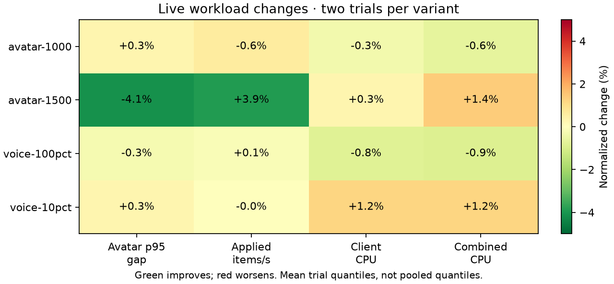
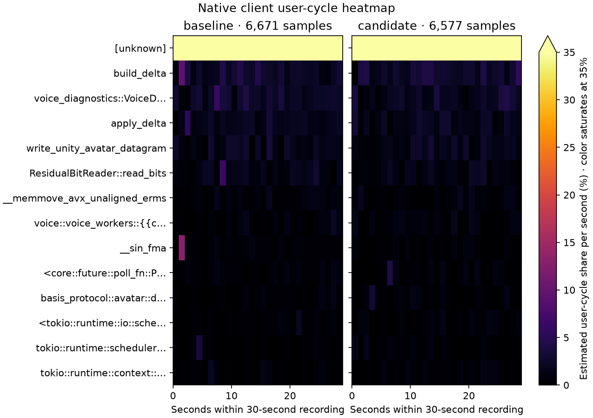

# Voice datagram buffer — rejected, 2026-10-13

Rejected and reverted. A task-local reusable datagram removed two framing allocations and one copy per voice packet after warmup, preserving emitted bytes and playback policy. The matched 100-speaker case modestly improved client CPU, but the 250-speaker overload delivered substantially fewer avatar updates. That trade-off did not justify retention.

The experiment changed only client framing. Frozen server `58bae36066f82366` stayed identical; control client `a640179b1f2e3280` and candidate `a03eb9c4b3d41811` used locked release builds with `CARGO_PROFILE_RELEASE_DEBUG=1`. Real 20 ms mono Opus clips, fixtures, ports, four client workers, 16 server workers and 20/60-second warmup/measurement windows matched. A/B/B/A supplies two observations per variant; means are observations on a shared host, not significance estimates or pooled quantiles.

## Eligible workloads

All 16 live captures pass measured delivery, coverage, error, delta, voice cadence, fanout, hash and decode gates. Setup retries remain separate from zero measured retries. All four micro suites pass 12 commands / 37 subcases.

| Workload | Avatar p95 gap, ms | Applied items/s | Client CPU, cores | Client user CPU, cores |
|---|---:|---:|---:|---:|
| 1,000 avatars | 154.88 → 155.34 | 6918 → 6876 | 0.5583 → 0.5565 | 0.1804 → 0.1819 |
| 1,500 avatars | 326.97 → 313.51 | 5147 → 5346 | 0.8545 → 0.8571 | 0.2775 → 0.2748 |
| 250 clients / 25 speakers | 21.60 → 21.66 | 12280 → 12277 | 0.9477 → 0.9591 | 0.3347 → 0.3414 |
| 100 clients / 100 speakers | 20.77 → 20.71 | 4924 → 4931 | 1.0989 → 1.0900 | 0.3255 → 0.3167 |

At 100 speakers, mean client total CPU decreases 0.81% and user CPU 2.71%, with similar delivery and cadence. At 25 speakers, client total CPU increases 1.21% and user CPU 1.99%. Avatar-only timing changes are not attributed to voice framing.

## Overload screen

All four 250-client/250-speaker captures fail capacity gates. Failed cadence, fanout, reordering and workload validation remain visible; this is a diagnostic workload, not supported capacity.

| Metric | Control mean | Candidate mean |
|---|---:|---:|
| Avatar applied items/s | 1512 | 1184 |
| Avatar p95 gap, ms | 287.99 | 295.85 |
| Voice packets sent/s | 10398 | 10483 |
| Nominal voice send rate achieved | 83.19% | 83.86% |
| Unique receipt / expected voice fanout | 88.27% | 88.08% |
| Client total CPU, cores | 3.9924 | 3.9932 |
| Client user CPU, cores | 1.0688 | 1.0517 |

Avatar application falls 15.47% and 28.46% in the two crossover orders, 21.72% in the mean. Slightly more voice work and lower user CPU do not establish an improvement while avatar delivery declines. The mechanism remains unisolated. The candidate was restored from saved controls after all captures; earlier accepted optimizations remain intact.

## Native profiles and correctness

Matched 100-client/100-speaker 30-second, 199 Hz `cycles:u` / DWARF recordings pass both workload validations and all capacity gates. Client profiles have 6,671 / 6,577 samples and zero lost samples; both server reports also record zero lost samples. Profile inputs and nonempty audio hashes match the live corpus. Replacement captures explicitly use 16 Tokio and Rayon workers; original automatic-worker profiles remain preserved and excluded. Strengthened comparison guards verify paired files, driver status, configuration, fixture and corpus identity, and both targets' lost-sample reports.

Unknown symbols account for 77.70% / 78.95% of recorded client cycle periods and remain in the denominator. Unresolved kernel-tagged addresses in this user-cycle event are not attributed to a user function or measured kernel cycles. These profiles do not isolate framing allocation cost. Heatmap colors explicitly saturate at 35%.

The candidate passed 118 client workspace tests, formatting and all-target client-core Clippy with warnings denied. Real-UDP differential checks cover 100 Cartesian connection-number/sequence/payload-size combinations, stale-tail reuse, disconnected no-op ordering and empty-buffer growth/reuse. Final independent OpenCode Muse Spark review found no correctness issue.

The `captures/optimization-evidence-20261014/docs/performance/optimization-20261013-voice-send.json` (local only), PNG/SVG heatmaps, source controls, rejected patch, frozen binaries, profiler data and all failed stress results are preserved. Raw artifacts are under `captures/optimization-followups-20261013/voice-send/`; no audio is checked in.
