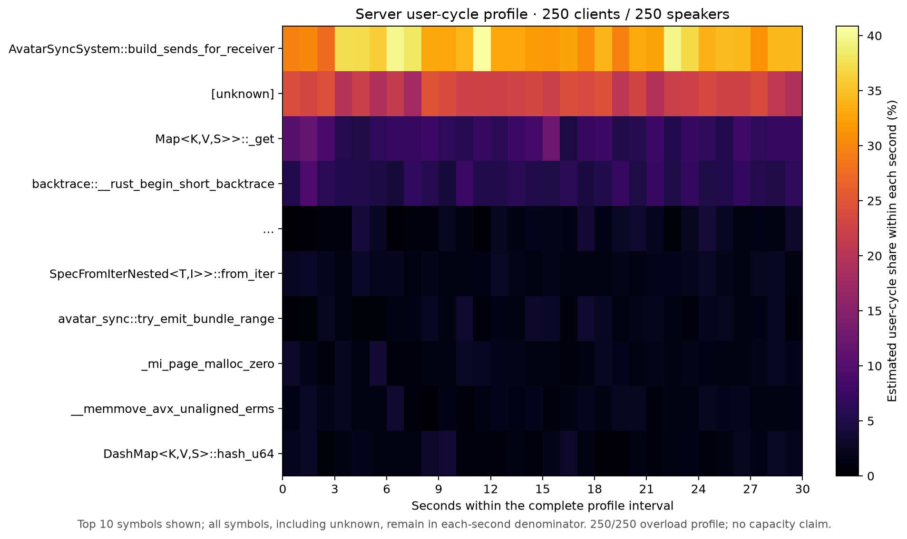
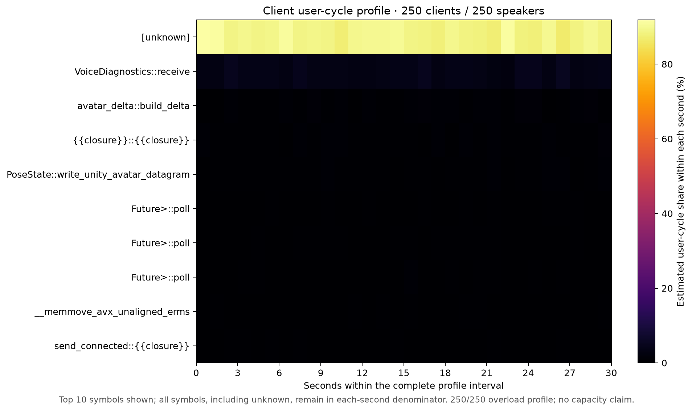

# Voice overload diagnosis — 2026-10-13

The 250-client / 250-speaker workload still fails capacity and avatar freshness gates. Two additional profiled observations locate a substantial loss stage: approximately **11.5–11.6% of received source frames are replaced in the server's bounded voice inbox**. The client sends only **83.1–83.8%** of the nominal rate. This identifies further work; no queue policy or workload setting was changed to claim a speedup.

Both observations use the final accepted frozen server/client, real mono 20 ms Opus corpus, four client workers, 16 server workers, fixed ports, 20-second warmup, and 60-second measurement window. Added server counters and native profiling create overhead. These are diagnostic observations, not matched unprofiled throughput comparisons.

| Measurement | Observation 1 | Observation 2 |
|---|---:|---:|
| Server received source frames/s, estimated | 10,401 | 10,492 |
| Inbox replaced source frames/s, estimated | 1,192 | 1,214 |
| Replaced / received | 11.46% | 11.57% |
| Handed-off source frames/s, estimated | 9,209 | 9,277 |
| Source expiration / lane replacements / expired deliveries | 0 / 0 / 0 | 0 / 0 / 0 |
| Unique expected fanout received | 88.24% | 88.11% |
| Voice observer p95 gap floor, ms | 134 | 237 |

Counters are cumulative from server startup. The analysis linearly interpolates values at the measurement marker and marker + 60 seconds using adjacent roughly one-second rows, with no extrapolation. These rates are estimates, not exact buckets. Pending-frame samples peak at 234 / 111 but do not capture every burst. Source frames, lane batches, datagrams, and recipient deliveries have different units; their totals cannot be directly equated.

Both observations preserve failed nominal send-rate, unique receipt, reordering, p95, stale-avatar, and unapplied-delta gates. Authentication, sender progress, audio hash/decode, malformed-packet, and send-error checks pass. Similar replacement and missing-fanout fractions support inbox pressure as a significant loss stage, without proving all loss originates there or describing physical-network capacity.

## Native profiles

Observation 1 requested a 65-second sample; both perf processes exited with SIGTERM. Its raw data remains excluded from profile conclusions. The exact termination source is unconfirmed. Observation 2 samples for 30 seconds inside the unchanged measurement window: both perf processes and report commands exit zero, with **24,474 server / 23,761 client samples and zero lost samples**.

The server's recorded event-period share includes `build_sends_for_receiver` at 34.15%, DashMap lookup at 6.98%, and unknown symbols at 22.11%. The client profile is **89.06% unknown**, which limits useful attribution; `VoiceDiagnostics::receive` is 3.60% of the complete recorded denominator. Unknowns are preserved rather than redistributed among identified functions. Process counters separately show substantial kernel CPU: about 2.65 server / 2.92 client cores in observation 2, compared with 1.31 / 1.07 user cores. `perf evlist -v` confirms `cycles:u` with `exclude_kernel: 1`, despite unresolved kernel-tagged sample addresses in the report. Their cause remains unconfirmed; those addresses neither identify a user-space hotspot nor establish measured kernel cycles. Zero lost samples confirms record retention, not symbol quality.

Next experiments should isolate client scheduling/socket pressure and server inbox drain timing while retaining all delivery validation. Increasing queue limits without measuring tail latency could trade replacement for stale audio and is not justified by these observations alone.

Raw commands, binaries' hashes, attach timing, completion statuses, CSV endpoint brackets, validators, complete symbol shares, and native captures remain in `captures/optimization-followups-20261013/voice-diagnostics/run-01/` and `run-02/`. The ignored local capture and analysis drivers are in their parent directory. All exported heatmaps are available as PNG and SVG.
