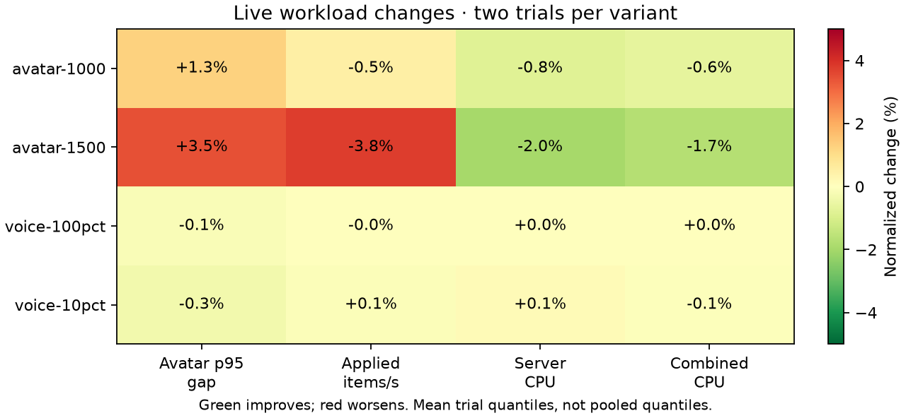
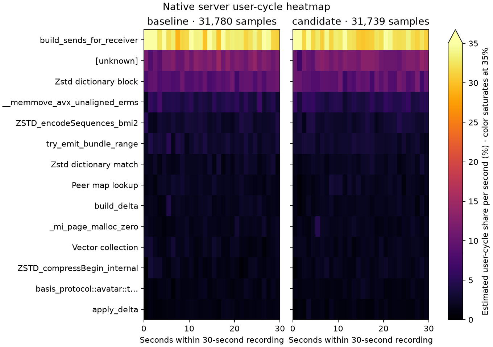

# Zstd Vec destination — rejected, 2026-10-13

Reverted the safe `Vec::with_capacity` destination and its common `zstd-safe/std` prerequisite. The compressor screen improved most cases, but the live cohort delivered fewer updates at 1,500 avatars in both crossover orders. Lower CPU therefore does not establish a useful gain. Earlier accepted optimizations remain intact.

The experiment changed only output allocation and the zstd-safe destination type; session reset, parameters, dictionary, flags, wire bytes and errors were preserved. Muse Spark found no blocking safety or compatibility issue. New boundary and post-error recovery tests passed.

## Matched evidence

Both variants used the same locked release flags, features, harnesses, fixtures and frozen inputs. All four micro suites passed 12 commands / 37 subcases; all 16 live captures passed measured delivery/coverage/error and voice cadence/fanout/hash/decode checks. Cumulative setup retries were kept separate from zero measured retry deltas. Fixed workers: server Tokio/Rayon 16, client 4; warmup 20 seconds, measurement 60 seconds.

| Workload | p95 gap, ms | Applied items/s | Server CPU, cores | Client CPU, cores |
|---|---:|---:|---:|---:|
| avatar-1000 | 153.64 → 155.59 | 6943 → 6910 | 4.6014 → 4.5637 | 0.5566 → 0.5614 |
| avatar-1500 | 314.20 → 325.11 | 5296 → 5097 | 4.9509 → 4.8538 | 0.8539 → 0.8520 |
| voice-100pct | 20.73 → 20.70 | 4931 → 4931 | 1.6443 → 1.6447 | 1.0935 → 1.0941 |
| voice-10pct | 21.52 → 21.45 | 12301 → 12314 | 2.9051 → 2.9092 | 0.9486 → 0.9424 |

At 1,500 avatars, p95 gaps worsen 3.47%, application throughput falls 3.77%, and server CPU falls 1.96%. Both orders deliver fewer updates. At 1,000 avatars the changes are smaller: p95 +1.27%, items −0.48%, server CPU −0.82%. Voice results stay close to flat. These are two observations per variant; means of run quantiles are not pooled quantiles.

The complete cached compressor screen includes allocation, session reset and compression across seven sizes, two patterns and levels 1/3, eight observations per arm. Byte equality, decoding, checksum and operation counts are checked outside timing. Most cases improve 0.4–8.4%; the worst observed slowdown is 0.60%. The live fixture uses level −2. This screen supports a component observation, not a deployment decision. Short preliminary screens remain excluded.

Matched 30-second `cycles:u` / DWARF server recordings contain 31,780 / 31,739 samples, zero lost samples. Zstd leaf shares are 17.56% → 18.29%; unknown shares 11.60% → 11.52%, included in the denominator. Relative cycle shares do not measure absolute CPU savings. Client recordings also pass zero-lost checks.

Candidate validation passed 365 server and 116 client release tests, both hardware GPU parity tests, formatting and protocol all-target Clippy with warnings denied. The new exact-byte tests cover empty through 65,535-byte inputs, compressible/dense data and destination-error recovery.

The `captures/optimization-evidence-20261014/docs/performance/optimization-20261013-zstd.json` (local only), native and micro heatmaps, matched sources/build logs, corpus screen and Muse review are retained. Raw evidence: `captures/optimization-followups-20261013/zstd-buffer/`. Rejection restores its three explicit source controls and removes the experiment-only harness; accepted clean delta remains.
