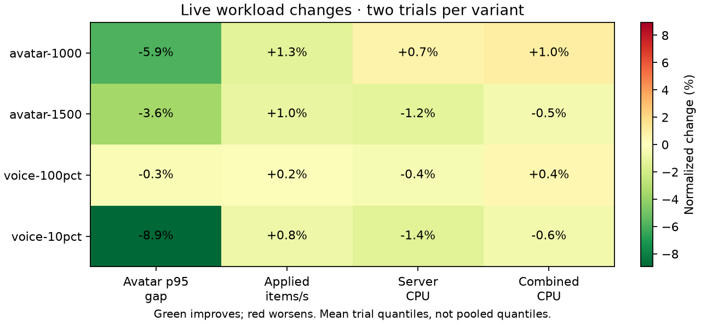
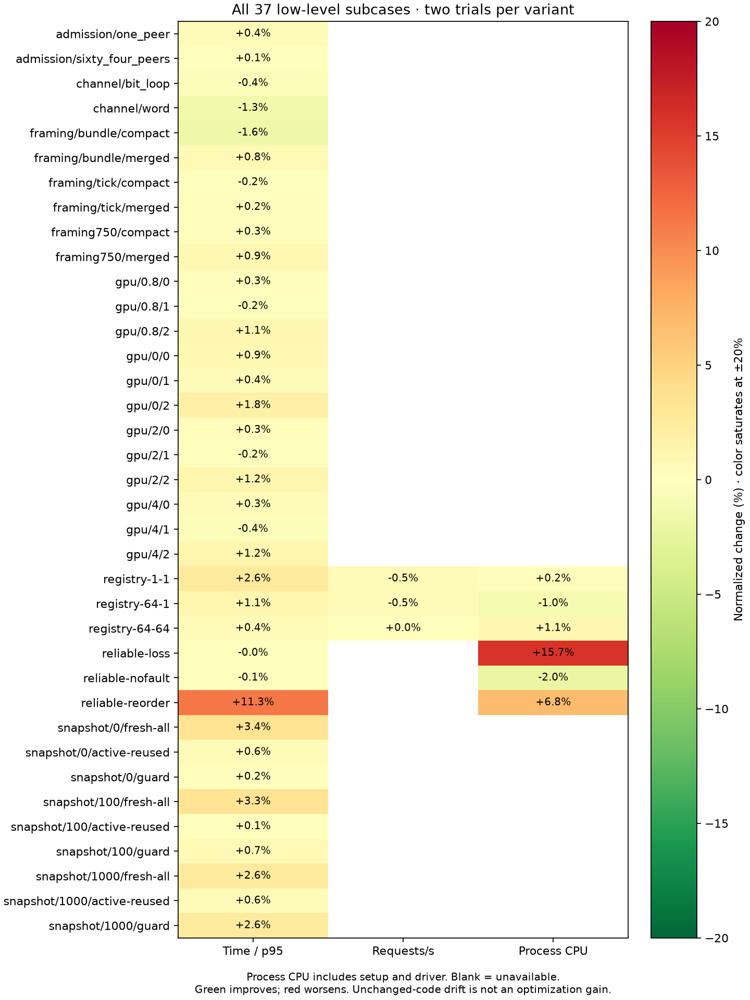
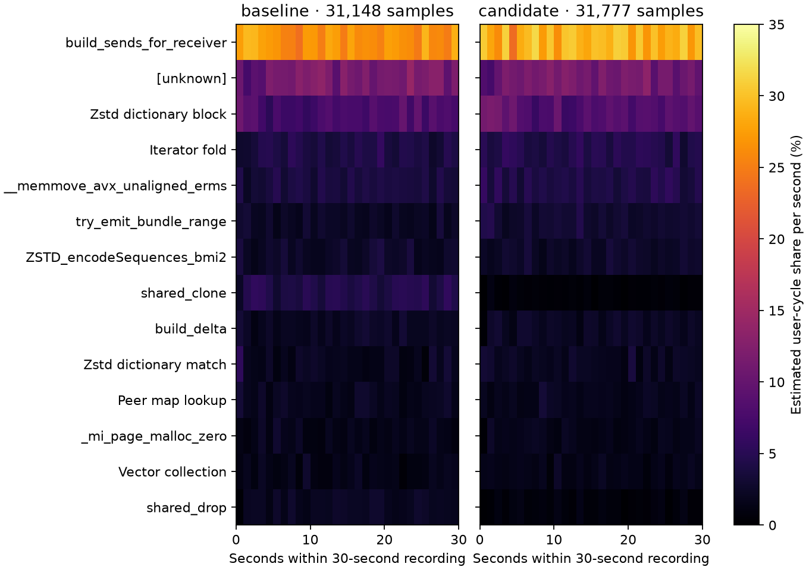

# Payload ownership optimization — 2026-10-13

Retained: avatar bundle assembly borrows payloads from the immutable tick snapshot instead of cloning `Bytes` for every receiver/sender pair. Cache keys still retain owning clones to prevent backing-address reuse. Uncompressed bundle tails now borrow the same payload and use the transport's existing interval patch, avoiding a separate patched allocation. Wire contents, compression policy, sender selection, admission limits and scheduling settings are preserved.

The subsequent [shared membership snapshot comparison](optimization-20261013-membership.md) starts from this accepted candidate and measures an additional change separately.

The clearest measured result is the 1,500-client case: mean trial avatar p95 gaps fell **3.6%**, observer application increased **1.0%**, and server CPU fell **1.2%**. Both crossover orders improved this case's p95, delivery and server CPU. These are two observations per variant on one shared host, not statistical significance or a universal capacity claim.

## Live comparison

Control is committed `8d244b3a54fc465daa74e279028a4214fc21c6d3`; candidate adds the ownership change in `avatar_sync.rs`. Each case ran sequentially in **A/B/B/A** order, twice per variant. Values below are means of per-trial quantiles/rates, not pooled quantiles. CPU uses actual process-counter endpoints (about 58 seconds); observer windows are 60 seconds.

| Workload | Avatar p95 gap, ms | Observer applied items/s | Server CPU, cores | Combined CPU, cores |
|---|---:|---:|---:|---:|
| 1,000 avatars | 176.88 → 166.42 | 6485 → 6568 | 4.702 → 4.734 | 5.302 → 5.354 |
| 1,500 avatars | 344.28 → 331.85 | 4909 → 4959 | 5.040 → 4.980 | 5.936 → 5.907 |
| 250 clients / 25 speakers | 25.00 → 22.77 | 12045 → 12141 | 3.498 → 3.450 | 4.461 → 4.435 |
| 100 clients / 100 speakers | 20.82 → 20.75 | 4918 → 4925 | 1.785 → 1.778 | 2.888 → 2.901 |

All **16 comparison captures** passed measurement-window eligibility: every client remained authenticated/active, every expected observer peer was covered, every avatar sender exceeded 2,900 successful sends, and measured send/decode/protocol/delta/sequence/drop checks passed. Voice cases additionally passed offered-cadence, unique fanout receipt, payload/hash and Opus decode checks for all receiving clients.

The 1,000-client case had a small combined CPU increase and unchanged mean median gap. Its control p95 changed from 160.45 to 193.32 ms; the first forward candidate trial was worse than its control, while the reverse trial was better. Its mean p95 improvement is therefore less convincing than the 1,500-client result. The 100-speaker case is essentially flat. This is not evidence that every case became faster.

Some 1,500-client captures fail the legacy **cumulative** `zero_retransmits` check because reliable setup traffic retried before measurement. Every compared capture had a **zero retransmit delta within measurement**. Both strict results and setup counts remain in the JSON; no failing trial was hidden or replaced.



## All low-level benchmarks and native profiling

All **12 command cases / 37 subcases** passed in both four-run cohorts:

- Registry UDP/ordered dispatch: 1 peer/1 in flight; 64 peers/1; 64 peers/64. Exactly 32,768 committed operations, valid final state, empty ACK windows and zero ACK/protocol errors per trial.
- Reliable transport: nofault, loss and reorder; 512 messages per case, exact unique ordered delivery and payload checks.
- Admission: 1 and 64 peers; five internal samples each.
- Peer snapshots: 0/100/1,000 active peers × guard/fresh-all/reused-active strategies; six internal samples each.
- Protocol channel extraction: bounded word extraction and former bit loop, with identical checksums.
- Client framing: tick/bundle × Merged/CompactMerged; full 750-client framing soak. These harnesses report minima of their internal rounds.
- Hardware GPU distance consumption: four position phases × CPU arithmetic/packed decisions/exact GPU snapshot, eight alternating internal rounds. All 3,998,000-pair checksums match; hardware GPU parity checks also pass. This measures result consumption, not full live GPU server capacity.

The first micro cohort was interleaved with long live suites. It showed 2–9% slowdowns even in byte-identical transport/protocol/client executables and 6–10% slower GPU consumption. A **predeclared adjacent A/B/B/A confirmation**, with no live loads or builds between its micro suites, reduced those differences: registry rates were within 0.6%, and phase-zero GPU modes within 1.8%. The main micro heatmap uses this confirmation. The original cohort remains in `captures/optimization-evidence-20261014/docs/performance/optimization-20261013-interleaved.json` (local only); the full confirmation is in `captures/optimization-evidence-20261014/docs/performance/optimization-20261013.json` (local only). Timing drift in unchanged executables is not credited to this optimization.

`perf stat` collected task-clock, cycles, instructions, cache references/misses and context switches for every low-level command. These counters include process setup, teardown and any UDP driver; they are not isolated server CPU or attributable to individual subcases inside a test command.

Separate 1,500-client diagnostic captures recorded server and client with `perf record`, `cycles:u`, 199 Hz and 8 KiB DWARF call stacks for 30 seconds. Server records contain 31,148 control / 31,777 candidate samples, with **zero lost samples**. Event-period-weighted combined `shared_clone`/`shared_drop` share fell **6.58% → 1.21%**. Sampling shares are relative costs, not absolute CPU times; other functions' shares can rise as ownership work falls. The time heatmap excludes the last partial second and retains unknown symbols.





PNG and standalone SVG exports are checked in for each heatmap. Full DWARF recordings, client/server reports, raw samples, CSVs, logs, hashes, frozen binaries and every failed/diagnostic capture remain locally in ignored `captures/optimization-20261013/`.

## Overload and scope limits

Both 250-client / 250-speaker stress captures **failed capacity and avatar freshness/delta checks**. Offered voice cadence was 83.1% / 82.6% of nominal and unique receipt was 87.4% / 87.7% of offered fanout; avatar p95 was 281.38 / 335.22 ms. These unreplicated overloaded captures are retained, excluded from eligible speed claims, and establish no improvement in 250-speaker capacity. The matched 100-speaker case was selected after the control overload screen, before candidate comparisons.

Host: Linux, Ryzen 9 5900HX (16 logical CPUs), RTX 3080 Laptop Vulkan GPU, performance governor, Rust 1.95.0. Locked release builds used debug information level 1 and default allocator settings. No build/test suite ran during timed measurements. Desktop activity was not isolated and affinity was not pinned. Windows ETW/native runs and physical-network capacity were not measured. Settings-sweep/crossover wrappers reuse the avatar workload; runtime settings were kept fixed rather than swept.

Every live run used the CPU-only fixture, fixed loopback ports 64142/64353, 16 server Tokio/Rayon workers, four client workers, 20-second warmup after readiness and a 60-second window. Clients were colocated with zero movement jitter, Unity-policy 60 FPS packing, no P2P, and no server pair/BSR diagnostics. Avatar-only runs use the existing load-sink receive policy with one full observer; voice runs disable shared receive/filtering and measure every client's voice. Applied gaps and voice arrival histograms are not end-to-end motion/audio latency or observations of every avatar receiver.

The frozen client and all configurations were identical across revisions. The 40 source clips came from the user-confirmed `BasisRustClient/audio` corpus in the main checkout and were encoded once as mono 48 kHz, 32 kbps, 20 ms Opus using the repository's encoder flags. Voice reencoding was disabled during measurements. The local audio manifest retains source and encoded hashes; the JSON retains binary/fixture hashes and validates workload equality.

## Validation and reproduction

All **353 workspace release/GPU tests** passed, including the cache backing-lifetime regression. Every ignored benchmark, two hardware parity tests, all-target core/GPU Clippy with warnings denied, formatting and diff checks also passed. CodeRabbit reported no production findings; tooling findings were fixed and checked, including invalid-summary exit status, missing inputs, incomplete profiles, undefined percentages and single-profile plotting. Actual perf export/plot runs verified the local perf field format. T3's headless HTML preview was blocked by host AppArmor; exported figures were inspected directly and published inline.

The new [Linux runner](../../scripts/perf/run-linux-optimization-suite.py) records commands, hashes, hardware counters and status. Build frozen release copies with `CARGO_PROFILE_RELEASE_DEBUG=1` and `--locked`; build protocol/transport/client/GPU-core unit executables with `cargo test --release --no-run`. Copy the console/examples and printed test paths into each frozen directory as `server`, `registry`, `reliable`, `protocol`, `transport`, `client-tests`, `core-gpu`, plus the common workload `client`. Keep the baseline source separate and use the same client for every revision. The analyzer accepts per-suite manifests when separate frozen-directory manifests are unavailable; output folders must follow the demonstrated variant/suite/tag naming.

Example commands, from the repository root (output folders must be new):

```sh
python3 scripts/perf/run-linux-optimization-suite.py micro \
  --binaries captures/optimization-20261013/baseline \
  --client captures/optimization-20261013/baseline/client \
  --output captures/repro/baseline-micro-confirm1
python3 scripts/perf/run-linux-optimization-suite.py live \
  --binaries captures/optimization-20261013/baseline \
  --client captures/optimization-20261013/baseline/client \
  --audio captures/optimization-20261013/audio-20ms-mono \
  --output captures/repro/baseline-live-abba1
```

Repeat each cohort in baseline/candidate/candidate/baseline order with unique `confirm1`/`confirm2` (micro) and `abba1`/`abba2` (live) folders. Run `profile` separately for each binary and `stress --audio ...` separately from eligible trials. The encoder command per clip is `ffmpeg -i INPUT -vn -ac 1 -ar 48000 -c:a libopus -threads 1 -b:a 32000 -application audio -frame_duration 20 OUTPUT.opus`.

[The analyzer](../../scripts/perf/compare-optimization-suite.py) uses Python's standard library for validation/JSON, and matplotlib for standalone figures:

```sh
python3 scripts/perf/compare-optimization-suite.py captures/optimization-20261013 \
  --micro-tags confirm1 confirm2 --output docs/performance/optimization-20261013
```

Use `--no-plots` for JSON-only analysis. Original checked-in data can be read without local captures; recomputing requires the recorded raw inputs or new measurements. Two repeats per variant do not establish significance, absence of all regressions, or that further gains are exhausted.
