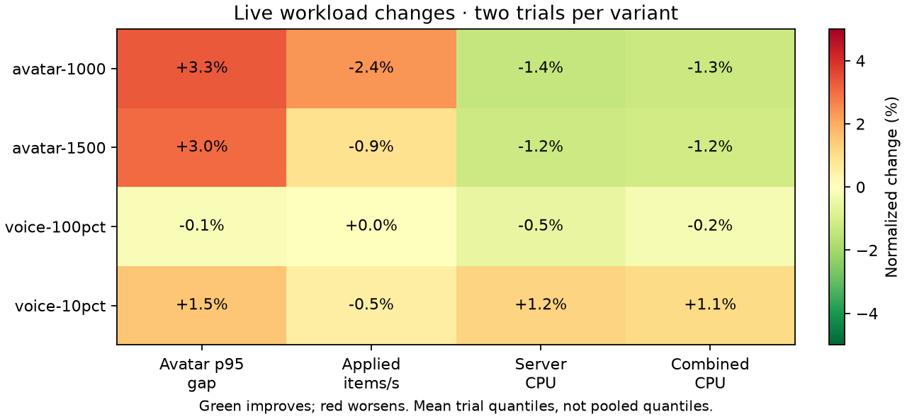
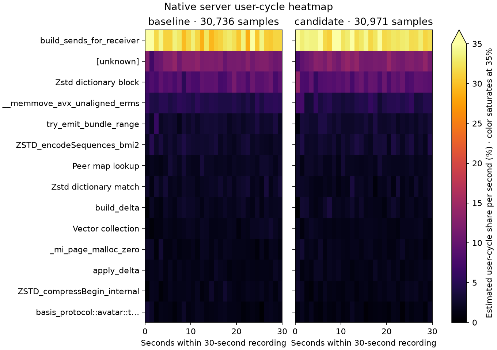

# Channel bitset confirmation — rejected, 2026-10-14

The new matched cohort confirms the 1,000-avatar delivery regression. Restored the original channel discovery; the accepted direct decoder remains. The earlier full-encoder gain does not justify reduced delivered work.

This pair holds the newly accepted decoder fixed and changes only Vec channel collection/sort/dedup to four presence words. The older [channel cohort](optimization-20261013-bundle.md) used the previous decoder. They are separate controlled comparisons and are not pooled as identical-revision observations.

All four micro suites pass 12 commands / 37 subcases; all 16 live captures pass measured delivery/coverage/error and voice cadence/fanout/hash/decode gates. Both variants use identical locked release flags, features, harnesses, fixtures, audio, 16 server Tokio/Rayon and four client workers, and 20/60-second windows. Setup retries remain separate from zero measured retry deltas.

| Workload | p95 gap, ms | Applied items/s | Server CPU, cores | Client CPU, cores |
|---|---:|---:|---:|---:|
| avatar-1000 | 151.97 → 157.02 | 6993 → 6826 | 4.5504 → 4.4865 | 0.5561 → 0.5559 |
| avatar-1500 | 301.60 → 310.69 | 5359 → 5309 | 5.0091 → 4.9471 | 0.8586 → 0.8524 |
| voice-100pct | 20.70 → 20.66 | 4931 → 4932 | 1.6426 → 1.6336 | 1.0930 → 1.0961 |
| voice-10pct | 21.45 → 21.77 | 12310 → 12245 | 2.8567 → 2.8922 | 0.9389 → 0.9448 |

At 1,000 avatars, application throughput falls 2.38% in both crossover orders, p95 worsens 3.32%, and server CPU falls 1.40%. At 1,500 avatars, mean throughput falls 0.93%, p95 worsens 3.01%, server CPU falls 1.24%; its two orders disagree on delivery. Voice results are close to flat, with 25-speaker delivery −0.53% and p95 +1.49%. Two observations per variant are a limited screen, but repeatable 1,000-avatar work loss is enough to reject. Means of run quantiles are not pooled quantiles.

Native 30-second `cycles:u` / DWARF server recordings contain 30,736 / 30,971 samples, zero lost. Vec collection leaf share changes 1.74% → 1.60%, unknown 11.72% → 12.01%; unknowns stay in the denominator. Both client reports also pass zero-lost checks. Relative shares are not absolute CPU savings.

Candidate checks pass 370 server and 116 client release tests, both hardware GPU parity tests, formatting and protocol all-target Clippy with warnings denied. All six byte-exact channel tests remain valid; correctness is not the reason for rejection. Original explicit avatar source control restored; no decoder rollback.

The `captures/optimization-evidence-20261014/docs/performance/optimization-20261014-channel-confirm.json` (local only), PNG/SVG figures, complete commands/build controls, frozen binaries and profiler data are retained under `captures/optimization-followups-20261013/bundle-channels-confirm/`.
