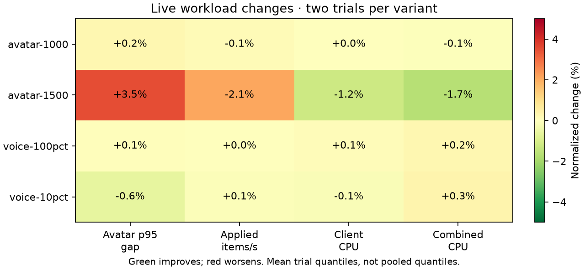
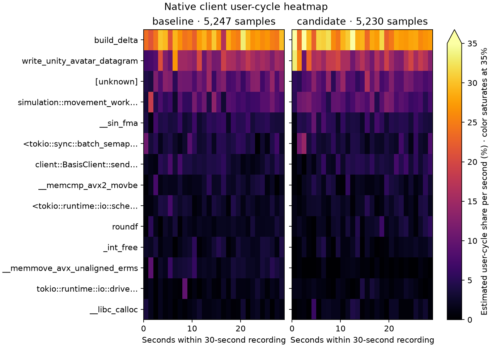

# Client payload borrow — rejected, 2026-10-14

Restored the existing serializer after a small component gain failed the live delivery screen. The candidate replaced one immutable `current_payload.clone()` with a local borrow; required keyframe and last-sent snapshots, packet bytes, gating, sequence and heartbeat behavior were preserved. Earlier quaternion packing and the accepted direct decoder remain.

The final matched screen times the actual production method in two frozen binaries, using identical locked release commands/features and `CARGO_PROFILE_RELEASE_DEBUG=1`. A common harness prepares 90 warmup frames and 65,536 monotonic timed frames at 60 Hz. Outside timing, it checks every emitted/suppressed outcome and packet byte against the frozen old method, plus sequence/keyframe/last-sent state and equal operation, type and output checksums. Across two process invocations per variant, eight rounds each, mean cost changes **952.10 → 925.52 ns (−2.79%)**. Both crossover orders improve (−2.69% / −2.89%). These are 16 correlated round observations per variant, not 16 independent processes; no confidence interval or universal process claim is made. The earlier −1.65% matched screen and the repeated-field prototype are preserved separately and excluded from this final result.

Both the Linux core test and shipped Linux client use the system allocator. MiMalloc in client `main.rs` is guarded by `cfg(all(windows, feature = "windows-mimalloc"))`; an initial review briefing incorrectly described an allocator mismatch, which was corrected after inspecting that guard. Windows was not measured. Verification outside the timer can still affect cache and branch state.

## Matched live validation

All four micro suites pass 12 commands / 37 subcases. All 16 live captures pass measured coverage, delivery, errors, delta/sequence and voice cadence/fanout/hash/decode checks. At 1,500 avatars, setup retransmits are nonzero in all four captures, but measured retransmit deltas are zero; those observations remain included. The six server-side binaries are byte-identical between variants. Only the client source changes; fixtures, real preencoded Opus corpus, 16 server Tokio/Rayon workers, four client workers, and 20-second warmup / 60-second measurement stay fixed.

| Workload | p95 gap, ms | Applied items/s | Client CPU, cores | Client user CPU, cores |
|---|---:|---:|---:|---:|
| avatar-1000 | 154.505 → 154.880 | 6934.73 → 6926.40 | 0.55811 → 0.55828 | 0.18371 → 0.17794 |
| avatar-1500 | 304.910 → 315.585 | 5396.40 → 5283.98 | 0.86026 → 0.84957 | 0.27771 → 0.27237 |
| voice-100pct | 20.680 → 20.695 | 4931.85 → 4932.31 | 1.09154 → 1.09243 | 0.32135 → 0.31920 |
| voice-10pct | 21.640 → 21.505 | 12289.43 → 12302.97 | 0.93824 → 0.93694 | 0.32702 → 0.32400 |

At 1,500 avatars, delivered items fall **2.08%**, p95 worsens **3.50%**, and client total CPU falls 1.24%. The first crossover order loses 4.17% delivery; the second is flat, while p95 worsens in both. At 1,000 avatars, total CPU and delivery are close to flat, with user CPU −3.14%. Voice delivery and cadence are close to flat. Two live observations per variant do not establish that this small code change caused the delivery loss, but they do not validate an acceptable production gain. Lower CPU accompanied by fewer updates is insufficient, so the change is reverted. Means of run quantiles are not pooled quantiles.

## Native evidence and checks

Matched 30-second `cycles:u` / DWARF client recordings contain **5,247 / 5,230 samples**, zero lost. Serializer leaf share changes **14.60% → 16.21%**, and unknown shares **9.98% → 9.62%** remain in the denominator. Both server recordings also pass zero-lost checks. Relative recorded shares are not absolute CPU savings and do not corroborate a whole-client speedup.

The candidate passes all 116 client release tests and formatting; Muse Spark found no semantic blocker in the supplied diff. The existing snapshots remain intact, and exact packet/state validation passes. After rejection, the explicit client source control and original test-module wiring were restored; the experiment-only benchmark module was removed from the production tree. The restored client again passes all 116 release tests and workspace all-target Clippy with warnings denied. Both workspaces pass formatting and the Git whitespace check. The unchanged accepted server revision retains its prior 364 release tests and both hardware GPU parity checks. Final check logs are retained.

The `captures/optimization-evidence-20261014/docs/performance/optimization-20261014-client-borrow.json` (local only), PNG/SVG figures, common benchmark source, matched controls, frozen binaries, commands, trial logs and native data are retained. Raw evidence: `captures/optimization-followups-20261013/client-payload-borrow/`. The next bundle-matching proposal remains unapplied because Marcus requested a stopping point.
