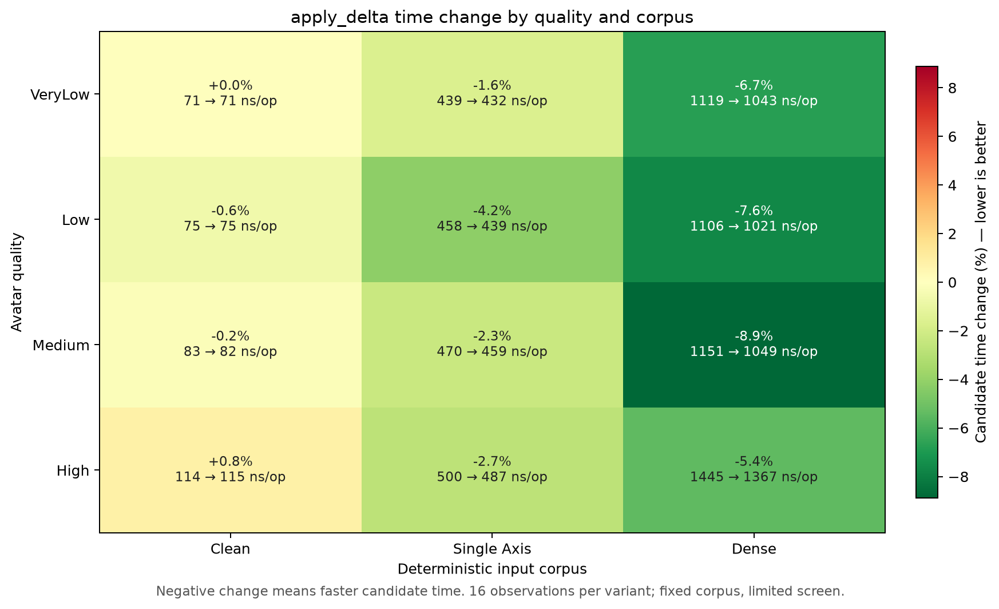
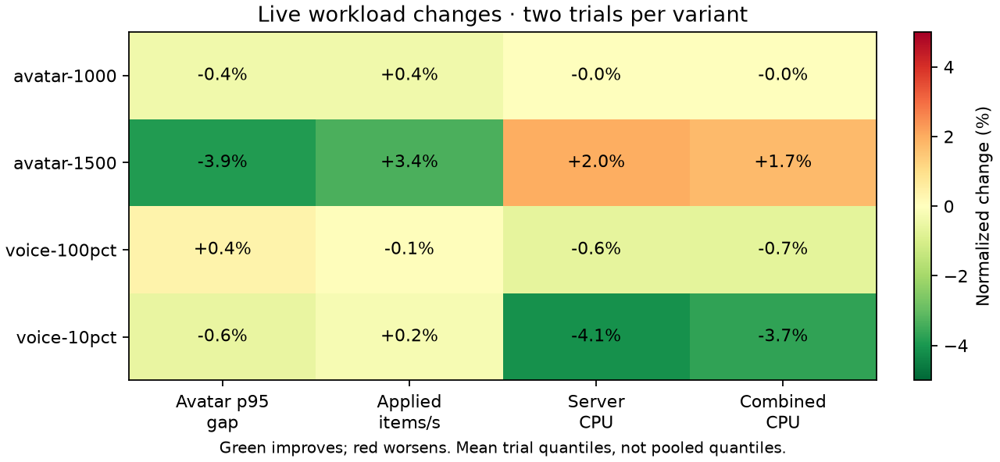
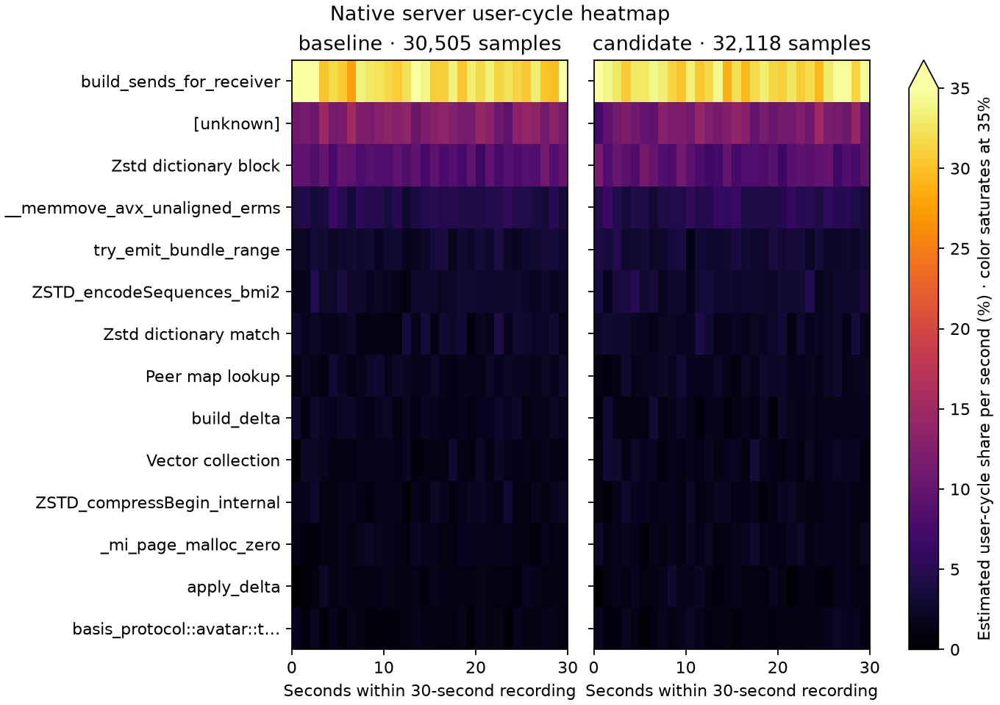

# Direct single-bit decoder — retained, 2026-10-14

`ResidualBitReader::read_bit` now reads one checked byte and extracts its bit directly. The general word reader is unchanged. The existing end-bit and actual backing-slice checks, error string and no-advance behavior are preserved. Bulk residual writing, exact-clean encoding and other accepted optimizations remain intact.

The matched final screen measures complete `apply_delta` calls, including allocation and a shared output-checksum loop. Across four qualities and clean/single-axis/dense corpora, dense cases improve 5.45–8.87%, single-axis cases 1.62–4.23%; clean cases are within 0.8%. There are 16 observations per variant per case from two process invocations per variant. Equal operation/corpus/live checksums, reference-decoder bytes, consumed lengths and truncated-prefix errors are required. Preliminary unformatted screens are retained separately and excluded.

Codegen is not identical: the preliminary `apply_delta` symbol shrinks from 0x5f0 to 0x570 bytes and signed Exp-Golomb decoding becomes outlined. That observation is not itself a speedup claim. Both final variants use identical locked release commands, features, harnesses and `CARGO_PROFILE_RELEASE_DEBUG=1`.

## Live validation

All four micro suites pass 12 commands / 37 subcases. All 16 live captures pass measured coverage, delivery, errors, delta/sequence and voice cadence/fanout/hash/decode gates. Setup retries remain separate from zero measured retry deltas. Server Tokio/Rayon workers are fixed at 16, client workers at four, with matching fixtures and preencoded Opus corpus, 20-second warmup and 60-second measurement.

| Workload | p95 gap, ms | Applied items/s | Server CPU, cores | Client CPU, cores |
|---|---:|---:|---:|---:|
| avatar-1000 | 154.30 → 153.72 | 6943 → 6968 | 4.5546 → 4.5531 | 0.5591 → 0.5586 |
| avatar-1500 | 321.64 → 309.09 | 5209 → 5384 | 4.8984 → 4.9946 | 0.8497 → 0.8530 |
| voice-100pct | 20.66 → 20.74 | 4934 → 4931 | 1.6451 → 1.6346 | 1.0996 → 1.0912 |
| voice-10pct | 21.57 → 21.45 | 12297 → 12324 | 2.9641 → 2.8417 | 0.9571 → 0.9342 |

At 1,500 avatars, p95 improves 3.90% and delivered items increase 3.36% in both crossover orders, while server CPU increases 1.96%. At 1,000 avatars, p95 −0.37% and items +0.36% are close to flat. Voice delivery/cadence stays stable; the 25-speaker runs show server CPU −4.13% and client CPU −2.39%. Two observations per variant do not establish a universal process CPU or capacity gain. Means of run quantiles are not pooled quantiles.

## Native evidence and checks

Matched 30-second `cycles:u` / DWARF server recordings contain 30,505 / 32,118 samples with zero lost samples. The sum of decoder leaf shares (`apply_delta` and `ResidualBitReader` methods) changes 2.11% → 1.38%. Grouping the leaves accounts for the new outlining; allocator descendants remain outside that group. Unknown shares 12.45% → 11.61% stay in the denominator. Relative recorded shares are not absolute CPU savings. Both client recordings also pass zero-lost checks.

The candidate passes 364 server and 116 client release tests, both hardware GPU parity tests, formatting and protocol all-target Clippy with warnings denied. The new direct test pins every bit position across a byte boundary, last-bit advancement, end/backing mismatches, `usize::MAX` and both signed Exp-Golomb truncation errors. Existing all-quality reference/truncation checks remain. Muse Spark reports no material finding. A Clippy type-complexity warning in the new harness was fixed with a common type alias before the final builds.

The `captures/optimization-evidence-20261014/docs/performance/optimization-20261014-read-bit.json` (local only), PNG/SVG figures, matched source controls, build/check logs, frozen binaries, corpus and profiler data are retained. Raw evidence: `captures/optimization-followups-20261013/read-bit/`.
