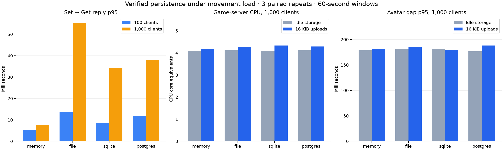

# Verified 16 KiB persistence workload benchmark

Frozen workload source: `cc2d0d71ea2426d4ba5775175571e9033376d681`. All 48 trials passed the eligibility checks.

## Workload and measurement

- 100 and 1,000 headless clients; memory, JSON file, SQLite WAL and PostgreSQL backends.
- Three paired repeats per population/backend, uploads off versus on. Backend order rotates; control/treatment order alternates.
- Each client moves using the Unity-policy simulation at nominal 50 Hz in groups of ten, spaced 1,000 units apart. Voice, image and scene workloads are disabled.
- Persistence sends exact 16,384-byte changing pseudo-random values every nominal 10 seconds, with staggered initial phases. Each successful Set is followed by a Get and full byte comparison.
- 20-second warmup after full authenticated population, then a 60-second observation window and 3-second drain. One Set/Get chain may be in flight per client.
- Server logical CPU affinity: `0-7`, 8 Tokio/Rayon workers. Client affinity: `8-11`, 4 runtime workers. PostgreSQL affinity: `[12, 13, 14, 15]`. Host process allowed logical CPUs: `[0, 1, 2, 3, 4, 5, 6, 7, 8, 9, 10, 11, 12, 13, 14, 15]`. Physical-core topology was not recorded.
- Legacy trial records omit `server_workers, client_workers, drain_seconds`; those values are configured settings from the manifest, not independently cross-checked per trial.
- Latency is application RTT over the actual v56 reliable/fragmented Basis protocol, including sealed client uplinks: Set enqueue to its reply, Get enqueue to its reply, and Set enqueue to Get reply arrival. Readback correctness is required separately. Histograms use 0.1 ms bins; no overflow occurred.
- CPU is CPU-seconds divided by measured wall-seconds (1.0 = one logical CPU fully busy). RSS is the maximum sampled at 1 Hz. PostgreSQL CPU is separate from the game-server process; summed database RSS is retained only in raw artifacts because shared pages are double-counted.
- Eligibility requires the full population and avatar state count at every 1 Hz sample, at least 95% of nominal avatar uplinks and persistence offers, every client completing a verified write, and no failed storage statuses/integrity errors/timeouts/cancellations/pending requests. The avatar observer requires all nine expected nearby peers, no stale peers at window end, and no decode failures.

## Results

Numbers below are medians of three per-trial values. The latency range is the minimum/maximum per-trial p95, not a confidence interval. CPU deltas are medians of matched-pair differences. Nominal offered storage load: 10 writes/s (100 clients), 100 writes/s (1,000 clients); these results do not establish maximum backend capacity.

| Clients | Backend | Idle server CPU | Upload server CPU | Paired CPU delta | Verified writes/s | Set→Get p50 ms | p95 ms (range) | p99 ms | Avatar p95 idle→upload ms |
|---:|---|---:|---:|---:|---:|---:|---:|---:|---:|
| 100 | memory | 0.744 | 0.737 | -0.011 | 9.97 | 4.2 | 5.2 (5.2–5.3) | 5.5 | 20.4→20.4 |
| 100 | file | 0.722 | 0.745 | +0.023 | 9.97 | 8.6 | 13.8 (12.1–14.1) | 16.0 | 20.4→20.4 |
| 100 | sqlite | 0.722 | 0.747 | +0.020 | 9.98 | 5.7 | 8.5 (7.9–14.0) | 20.2 | 20.4→20.4 |
| 100 | postgres | 0.725 | 0.747 | +0.023 | 9.97 | 8.0 | 11.7 (11.6–11.9) | 13.6 | 20.4→20.4 |
| 1,000 | memory | 4.094 | 4.172 | +0.096 | 99.95 | 4.6 | 7.7 (7.2–7.7) | 9.4 | 178.7→180.7 |
| 1,000 | file | 4.117 | 4.279 | +0.183 | 99.77 | 27.2 | 55.4 (51.9–62.8) | 71.1 | 181.7→184.9 |
| 1,000 | sqlite | 4.099 | 4.337 | +0.227 | 99.90 | 15.0 | 34.2 (32.4–34.4) | 41.6 | 181.4→179.8 |
| 1,000 | postgres | 4.115 | 4.293 | +0.178 | 99.78 | 16.5 | 37.9 (37.7–38.1) | 79.9 | 176.6→188.2 |

## Interpretation

- All 48 trials were eligible: 79,072 Set/Get cycles passed full readback verification, every configured writer participated, and storage error, corruption, timeout and pending-request counters were zero.
- At 1,000 clients, memory has the lowest persistence latency; file persistence has the highest. PostgreSQL uses additional database CPU beyond the game-server CPU shown in the first table.
- The 1,000-client avatar baseline is already delayed with uploads disabled: per-trial avatar-gap p95 spans 174.8–198.6 ms. Passing the workload checks does not establish smooth 50 Hz downstream delivery. This baseline needs separate investigation before drawing an interactive-capacity conclusion.
- Small paired CPU changes, including negative values at 100 clients, are run variation rather than evidence that uploads improve performance.



## Request phases and resources with uploads

| Clients | Backend | Set p95 ms | Get p95 ms | Server peak RSS MiB | Client CPU | Client peak RSS MiB | Database CPU |
|---:|---|---:|---:|---:|---:|---:|---:|
| 100 | memory | 2.9 | 2.6 | 43.8 | 0.116 | 10.0 | — |
| 100 | file | 10.7 | 5.8 | 42.4 | 0.115 | 9.9 | — |
| 100 | sqlite | 5.7 | 3.4 | 47.2 | 0.116 | 10.0 | — |
| 100 | postgres | 9.4 | 3.6 | 47.6 | 0.116 | 9.8 | 0.027 |
| 1,000 | memory | 4.3 | 4.1 | 230.9 | 0.947 | 36.2 | — |
| 1,000 | file | 34.6 | 32.4 | 226.4 | 0.958 | 36.0 | — |
| 1,000 | sqlite | 21.1 | 20.5 | 197.1 | 0.951 | 36.4 | — |
| 1,000 | postgres | 31.8 | 16.1 | 218.6 | 0.962 | 35.3 | 0.266 |

## Environment and limits

- Host: AMD Ryzen 9 5900HX with Radeon Graphics; Linux-7.0.0-38-generic-x86_64-with-glibc2.39.
- This is a colocated CPU/storage test. PostgreSQL uses local TCP on a dedicated test service; WAN latency and remote TLS overhead are not represented. The client is headless and does not model Unity rendering cost.
- SQLite uses WAL with SQLx’s default FULL synchronous policy. File persistence uses atomic replacement and file/directory sync. PostgreSQL settings are recorded below.
- Three repeats characterize this host/workload only. Inspect all samples and ranges before generalizing small CPU or latency differences.
- Only the trials in the supplied results are summarized. Setup pilots and discarded runs are excluded; every included upload trial requires all configured writers.

```json
{"version" : "PostgreSQL 16.15 (Ubuntu 16.15-0ubuntu0.24.04.1) on x86_64-pc-linux-gnu, compiled by gcc (Ubuntu 13.3.0-6ubuntu2~24.04.1) 13.3.0, 64-bit", "fsync" : "on", "synchronous_commit" : "on", "shared_buffers" : "128MB"}
```

Server SHA-256: `b5bcbc001d543c06b2cf5569c2f841a49df97e85572fae06d9b43e060c4fd40f`  
Client SHA-256: `491c4e7b7cc1e258cd2dac1b8644d5dc42edd9411e9eb06e4e3f2163a640c8af`

All individual measurements are in [pr38-persistence-benchmark.csv](pr38-persistence-benchmark.csv). Raw health samples, logs, commands and manifests are retained locally at `/tmp/pr38-persistence-full-cc2d0d7`.

## Reproduce

Build SQL-enabled server and client release binaries. Supply a dedicated local PostgreSQL URL through `BASIS_BENCH_POSTGRES_URL`, matching libpq `PG*`/service settings for `psql`, and the owned PostgreSQL postmaster PID. Match the recorded database affinity (`[12, 13, 14, 15]`) before running. The benchmark uses Python standard-library tools and `psql`; report plotting additionally needs Matplotlib and NumPy (install them in a private virtual environment).

```sh
cargo build --release --locked --manifest-path BasisRustServer/Cargo.toml -p basis-server-console --features sql-storage
cargo build --release --locked --manifest-path BasisRustClient/Cargo.toml --bin basis-rust-client
python3 -B scripts/perf/run-persistence-benchmark.py \
  --server /path/to/frozen/server --client /path/to/frozen/client \
  --output /new/empty/output-path --postgres-pid YOUR_TEST_POSTMASTER_PID \
  --warmup-seconds 20 --window-seconds 60 \
  --interval-seconds 10 --drain-seconds 3 \
  --server-cpus 0-7 --server-workers 8 \
  --client-cpus 8-11 --client-workers 4
python3 -B scripts/perf/summarize-persistence-benchmark.py \
  --input /new/empty/output-path --output docs/performance/pr38-persistence-benchmark.md
```
