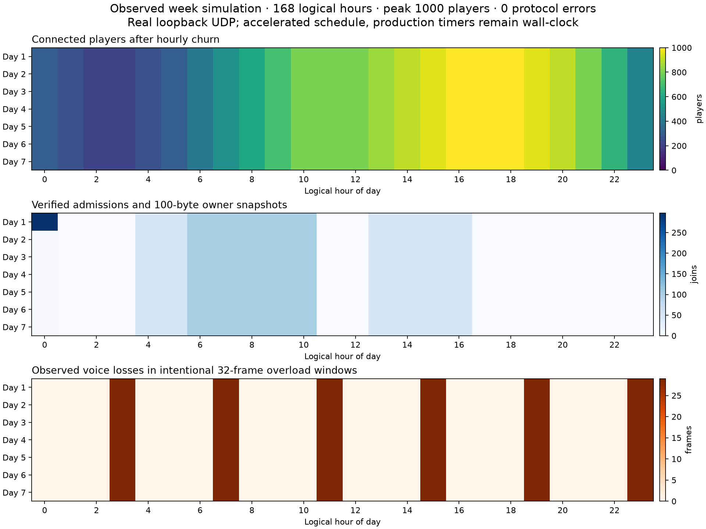

# One-week session and sync simulation

Run the ignored real-UDP integration test with a directory of pre-encoded, mono 48 kHz, 20 ms Ogg Opus clips:

```sh
python3 scripts/sim/run-week-sync.py \
  --audio captures/optimization-20261013/audio-20ms-mono \
  --output captures/week-simulation/full-1000-keepalive
```

The defaults simulate 168 logical hours with a peak of 1,000 connected players. The runner builds a locked release test binary with debug information, freezes it in the new output directory, records commands and source/audio SHA-256 hashes, and streams test output to `run.log`. The test writes `result.json` with hourly counts, join-sync p50/p95/max, voice delivery and overload loss, and protocol errors. The runner refuses to overwrite an existing output directory. Use `--peak`, `--hours`, or `--binary` to select a smaller run or an already frozen test executable.

The 100-byte scene payload is sent by a small Rust protocol actor that models a user-owned script using Basis scene messages. It is not Unity script execution. The owner sends the current byte array when a player joins. Join verification checks scene state alongside ownership, net-ID, and resource replay; the schedule also changes the owner and checks later snapshots. Although avatar packets contain generated face coefficients, Unity assets and face blendshape execution are not tested.

Each active player sends ten fixed advancing pose frames per hourly window, with a minimum 20 ms round interval and staggered sender chunks. Frames carry 52 generated face coefficients and dynamic face-data toggles. A rotating sender exercises four full/delta steps (three fixed advancing frames per step), linked-avatar changes, and explicit face-data removal. Sequence numbers reset on reconnect and wrap during the week. The observer sends real keyframe-control requests for missing delta baselines and repeats a convergence request after 100 ms without the expected state, within a 15-second bound; these requests are counted. During recovery the source also sends a fresh sequenced full frame at the same interval, allowing the receiver’s two-frame resynchronization after wall-clock silence; these extra frames are reported separately. This verifies eventual state convergence over UDP, not lossless avatar delivery. Voice recipients are configured through the wire using count and bitfield forms. The voice workload includes paced frames, three-frame jitter-like bursts, and 32-frame overload bursts with explicit loss accounting and recovery checks. A separate 30-frame stable voice stream overlaps the beginning of each hour’s churn and scene-sync window; its sender and observer stay connected. The harness also disables voice to verify that routing stops.

Disconnect cleanup tracks voice recipients by session incarnation and removes a departed session before its numeric peer ID can be reused. Leave delivery holds the join-delivery mutex, waits for earlier reliable messages to drain, and keeps IDs retired until surviving peers ACK the leave. This closes a cross-channel leave/join race that could otherwise restore stale membership. The waits add real head-of-line cost to admission; use the reported join-sync percentiles to assess it. The `WirePeer` actors drain reliable messages while waiting, so ACK retirement is exercised. They send client pings every second and reply to standalone or merged server pings to preserve idle connections through admission windows.

The logical clock advances by hour; production wall-clock timers are not aged across seven days. This is a single-host protocol simulation with a deterministic logical schedule. It does not execute Unity, load scene assets, render avatars, decode/play Opus, or validate physical-network behavior. The 40 normalized clips are hash-checked and provide sampled packets; the run does not play every packet in the corpus. One deterministic run is an observation, not a repeatability or universal capacity result.

## Results

The frozen release run passed all 168 logical hours (604,800 logical seconds) in 3,814.4 wall-clock seconds (63.6 minutes). It reached 1,000 players on every day. All 14 recorded source hashes, 40 audio hashes, and the frozen binary SHA-256 matched their recorded values. The runner manifest passed its peak, duration, corpus, and error checks.

| Check | Observed result |
| --- | ---: |
| Joins / leaves | 6,074 / 6,074 |
| Returning players | 5,074 |
| Owner transfers | 6 |
| Exact 100-byte join snapshots | 6,070 |
| Scene broadcast convergence windows | 168 |
| Exact avatar pose/face checks | 109,354 |
| Avatar frames sent, including recovery | 1,117,975 |
| Additional source recovery frames / convergence requests | 29,139 / 29,139 |
| Automatic missing-baseline requests at observer | 564 |
| Avatar admission rejections / protocol errors | 0 / 0 |
| Dynamic voice-off checks | 168 |

Join-to-script-sync latency over 6,070 samples was **49.7 ms p50, 59.0 ms p95, and 313.9 ms maximum**. This includes the real handshake, owner's join callback/snapshot, and verified ownership, net-ID, and resource metadata replay.

All 5,040 stable voice frames overlapping the beginning of churn windows and all 588 paced/three-frame-burst frames were byte-exact. The 42 intentional overload windows sent 1,344 burst frames; 126 arrived and 1,218 were counted as dropped. Each window's recovery frame arrived (42/42). No unexpected or duplicate received overload frame was accepted. Total active voice checks were 5,796 including concurrent streams and overload recovery. All 40 normalized Ogg Opus files were loaded (320,332 packets); the run samples packets from them and checks forwarding bytes, without playback decoding.

Avatar recovery counts include resynchronization after real wall-clock silence and lost UDP delivery; they are not a direct packet-loss rate. All exact state checks remained enabled. Final disconnect checks drained retiring IDs and verified empty authenticated-peer, ownership, voice-routing, and uplink-delta state before shutdown.

A 10-second perf snapshot at peak measured 94.14 CPU-seconds across the combined server/client process (about 9.4 cores), 301,338 context switches, and 25,083 CPU migrations. A separate 49 Hz CPU-clock profile had zero lost samples and attributed 70.86% of sampled CPU to `AvatarSyncSystem::build_sends_for_receiver`. This is a short snapshot, not a server-only CPU measurement or a before/after optimization result. Its data/report are retained in `captures/week-simulation/full-1000-keepalive/perf-stat.log`, `perf.data`, and `perf-report.txt`.

Earlier failed attempts are retained alongside this successful run. They exposed single-shot UDP assumptions, insufficient advancing frames after receiver silence, and missing idle-client/nested-ping handling in the fixture. The successful workload counts bounded keyframe recovery and uses normal keepalives. Production fixes for stale voice subscriptions and cross-channel ID reuse remain covered by focused regression tests.

Machine evidence is preserved locally under `captures/week-simulation/full-1000-keepalive/`; the archived documentation export is under `captures/optimization-evidence-20261014/docs/testing/`. JSON exports are not versioned. See the [exportable heatmap](week-simulation-20261014.svg).



Final regression checks passed: server workspace **360 passed, 6 ignored**; client workspace **116 passed, 3 ignored** (476 passed, 9 ignored, 0 failed total). Server Clippy passed with `-D warnings`; `cargo fmt --check` passed in both workspaces; `git diff --check` passed. Logs are in `captures/week-simulation/`.
